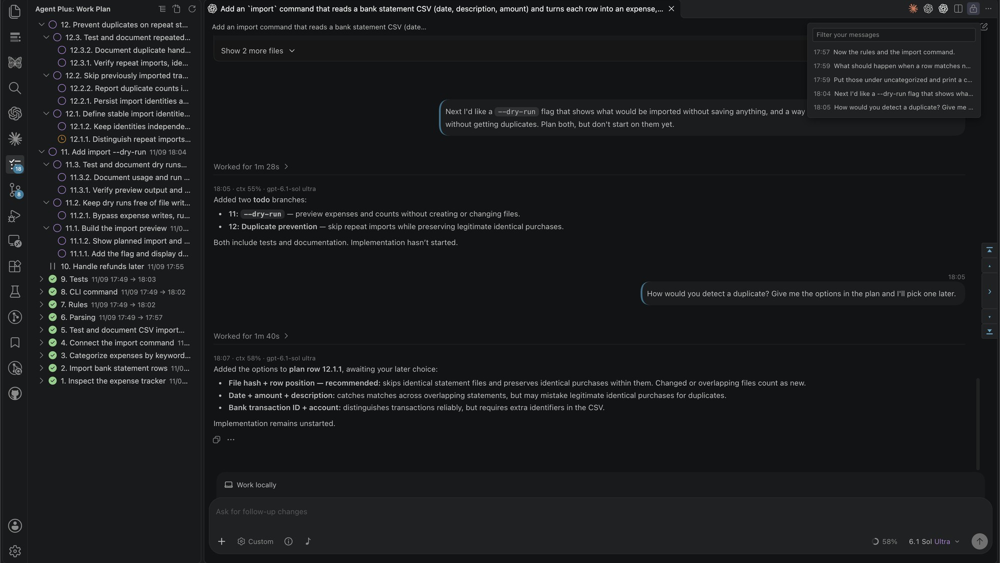
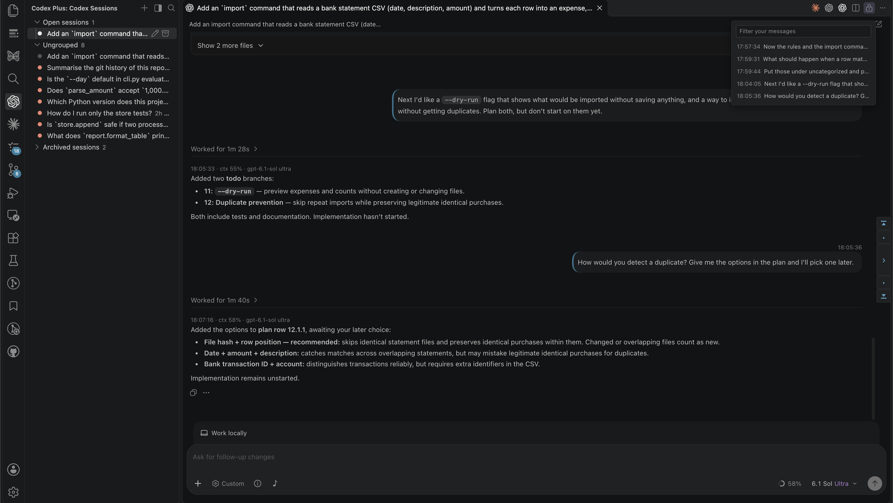

# Codex Plus

## What it looks like

A Codex conversation, with its work plan (the task list the agent keeps for it) on the left, in Agent Plus, the extension installed with this one:



The Codex sessions list in the Codex Plus sidebar:



## Features

| Feature | Where | Needs |
| --- | --- | --- |
| Codex conversations in the work plan, Conversations and Answer views | Agent Plus's views (its README says what each shows) | Agent Plus (installed with this extension) |
| Work plan per conversation: rows with states, numbered, kept across turns and compactions | Agent Plus's Work plan view; Codex's context every turn | Work plan plugin (installed into Codex by this extension), its hooks trusted |
| Plan changes through MCP tools `set_row` / `add_row`, no sandbox approval | Codex | Work plan plugin |
| Wake-ups: the model sets one with the MCP tool `set_wakeup` and removes it with `clear_wakeup`; when it is due, its prompt is queued for the conversation and Codex sends it once the conversation is idle. See Wake-ups | Codex conversations open in this window | Work plan plugin; patch (this extension's edit of Codex's installed files); `codexPlus.wakeUps` |
| The installed skills that best fit your message, put in front of Codex before each turn with their full descriptions; their names on the line under that turn's reply. See Skill search | Codex's context; Codex conversation | Work plan plugin, its hooks trusted; `codexPlus.skillRouting` |
| End-of-turn reminders: rows left `doing` (in progress), a reply that asks you something without putting the question on a row, a plan not brought up to date | Codex | Work plan plugin |
| Reminder to bring `doing` rows up to date before an automatic compaction, at 70% and 85% of where Codex compacts (90% of the model's window, or `model_auto_compact_token_limit` in `config.toml` when that is lower); pointer to the plan after one | Codex | Work plan plugin |
| Your time zone told to Codex when it runs on another machine, with this machine's zone and the time now; quiet while Codex's own page (its webview, in the sidebar or a tab) has told it the same zone since the last compaction (`<codex_apps_client_time_context>`) | Codex's context | Work plan plugin; the patch; `codexPlus.tellCodexYourTimeZone` |
| Answer a plan question (a question the agent put on a work plan row) from Agent Plus's Answer view: put in the conversation's message box (only when the box is empty) and sent, as Enter would send it; while a turn runs, Codex queues it or steers with it. The Answer view says whether it was sent, left as a draft, or refused because the box held a draft of yours | Codex tab, or Codex's sidebar when it shows the conversation | Patch; without the patch the answer stays in the Answer view |
| Account & usage, Recently closed and Open sessions, each with its count, then your groups and Ungrouped, as Claude Code with Claude Code Plus (this extension's counterpart for Claude Code) lays out its list. Recently closed has the conversation a tab showed when it closed, a tab opened with a New button included. A group you made is shown while empty too; Recently closed, Open sessions and Ungrouped are left out while empty | Codex sessions view, in the Codex Plus sidebar | Patch, for a tab opened with Codex's own New button |
| Drawn as Claude Code's list is, in the theme's colours: 28 px rows with an 8 px status dot, the title, and the time at the right, where Rename takes its place on hover; group names with their count in a badge; section labels in capitals; New in tab and New in sidebar side by side | Codex sessions view |  |
| The filter row: a status filter (Needs input, Working, Completed; Open or Closed tabs, each with its count), Active (needing input, working or unread), search by title, branch or four hex characters of the ID, and New group. Typing in the list starts a search; the arrow keys move through the rows, Enter opens one, Esc clears the search or the selection. Rows dragged onto a group's header move into it, onto Ungrouped out of any group | Codex sessions view |  |
| Each row's status dot, as Claude Code's list draws it: running green, waiting for you blue, replied and unread (see under the table) red, a failed last turn red, idle grey; running or waiting in another window, a ring of that colour | Codex sessions view |  |
| Open sessions covers tabs Codex opened with its own New button, whose URI names no conversation | Codex sessions view | Patch |
| Open sessions also lists the conversation Codex's sidebar shows while the sidebar is visible; clicking it goes to the sidebar. It is the conversation the sidebar last went to, so on the sidebar's own new-conversation page the conversation shown before it is still listed | Codex sessions view | Patch |
| New in tab / New in sidebar; Resume in tab / Resume in sidebar, offered only for a conversation not open in this window, as Claude Code Plus does | Codex sessions view | Nothing; the sidebar ones open Codex's own link, `vscode://openai.chatgpt/local/<id>` in this editor's scheme |
| Account & usage at the top of the list, as Claude Code has it: how Codex is signed in (Amazon Bedrock, an API key, or a ChatGPT account's email and plan), and only when Codex has the figures, for each rate limit the share used and when it resets, and the tokens spent today and in total. Asked of this window's app-server (the background process Codex starts for this window) when the list comes into view, at most once a minute, then kept current from the notifications Codex sends anyway | Codex sessions view | Patch; without it the section is not shown |
| Group and session ID on hover, as Claude Code Plus writes them | Codex sessions view |  |
| Time since a conversation was last used, and the first and last day it was used, as `11d · 09/05→09/16`: the time as `now`, `5m`, `3h`, `2d`, `1mo` or `1y`, and a date in another year with its year, as Claude Code's list writes them; title colours (Text Color, below); conversations started by `codex exec`, sub-agents and approval reviews (conversations Codex starts to review an approval request) left out, or listed with the rest, each sub-agent then indented under the conversation that started it (one whose parent is not listed stays among the rest), its hover naming that conversation | Codex sessions view | `codexPlus.hideBackgroundSessions` |
| Rename (a button on a row when hovered, and in its right-click menu), Text Color and Add to Group (each a list opened beside the right-clicked row, as Claude Code Plus's submenus are; at the top of the window when the list is not on screen), Remove from Group, and Mark as Unread or Mark as Read, several rows at once where that makes sense; on a group's header Start New Session in This Group, New Group, Rename Group and Delete Group. A conversation started in a group is moved into it once its first message is sent, which is when Codex lists it. The groups are Codex's own sections; their order is kept by this extension, since Codex keeps none, and Codex's built-in Pinned section is never offered as a group to add to. All but Mark as Unread and Mark as Read are sent to this window's Codex app-server on Codex's own connection, or before the patch is in effect to a short-lived one; those two are this extension's own read record | Codex sessions view |  |
| A conversation's goal, which Codex works toward on its own, starting another turn each time the conversation is idle until the goal is done, blocked or has used its token budget: Set Goal (with a budget, `codexPlus.goalTokenBudget`), Pause Goal, Resume Goal and Clear Goal in a row's right-click menu, and in the command palette for the conversation in front. A row shows its goal's state, as `goal`, `goal paused` or `goal: budget spent`, and its hover what the goal is and how many tokens it has used of its budget. Each change is sent as yours, to this window's app-server on Codex's own connection, or before the patch is in effect to a short-lived one | Codex sessions view; command palette |  |
| Rename, Mark as Unread and Add to Group in a Codex conversation tab's own right-click menu, as Claude Code has its three | Codex conversation tab |  |
| The row of the conversation in front is drawn as the current one, and scrolled to in Open sessions, as Claude Code's list follows it; the focus stays where it was | Codex sessions view |  |
| Codex button on the tab bar, and New in tab: a new Codex conversation in a tab, in an editor group already holding only Codex tabs, else one holding any Codex tab, else the first group (the main editor area); it never opens a new split. With the patch in effect the button is Codex's own, the only Codex button on the tab bar: set to `tab` (`codexPlus.tabBarButton`) it opens a conversation in a tab, set to `sidebar` it opens Codex's sidebar as it always did. Its hover still reads *Open Codex Sidebar*, Codex's own title for it, even with `tab` set. Without the patch this extension shows a button of its own, which set to `sidebar` starts a conversation in Codex's sidebar | Editor title bar; Codex sessions view | `codexPlus.tabBarButton`; the patch for Codex's own button |
| Tabs VS Code did not restore after a reconnect are opened again, and the status bar says how many for ten seconds, as Claude Code Plus says it | Editor tabs; status bar | `codexPlus.reopenDroppedTabs` |
| Ctrl+Shift+T (Cmd+Shift+T on a Mac) reopens the Codex conversation closed last, as Claude Code's shortcut reopens its last session, while the tab closed last was a Codex tab; after any other tab it is VS Code's Reopen Closed Editor | Editor tabs | `codexPlus.reopenClosedSessionShortcut` |
| Session information: thread ID, the process id of Codex's server for this window, folder, the conversation log Codex writes (its rollout) and its size, how much of the context window is in use, tokens the conversation used, the account | The information button in the message box's toolbar, where clicking a value copies it | Patch; `codexPlus.infoButton` |
| Chimes on or off from the note button beside the information button; struck through while they are off | Codex message box's toolbar, after the permissions button | Patch; `codexPlus.chime`, `codexPlus.chimeButton` |
| The Agent map, as Claude Code draws it: a pill reading like `2 agents · 1 timer · goal` while the conversation has a wake-up (the timer), a goal or sub-agents, and the dialog it opens, with a section for each of those the conversation has. The wake-up shows its interval, next time, end and prompt, with Remove; the goal its state and tokens, with Pause, Resume and Clear, or Set goal… when there is none; each sub-agent its status dot and when it was last active, and a click opens it in a tab. Esc or a click outside closes it | Codex message box's toolbar, left of the context meter; in the row this extension adds below the box when the toolbar has no room | Patch |
| Green / red / blue dot on a Codex tab's logo while working / replied and unread / stopped for your permission, in Claude Code Plus's colours and size; the tab titled by its conversation, kept in step as Codex names it, including a conversation started in a tab | Editor tabs | Patch |
| A conversation stopped for your permission shows as waiting in the Conversations view, puts the blue dot on its tab, and chimes | Conversations view; editor tabs; Codex tab | Patch; `codexPlus.chime` |
| Chime when a turn finishes, the model asks you something and waits for the answer (a blocking input request), or Codex stops for your permission; the three sounds are Claude Code Plus's own: rising for a finished turn, three equal notes for a permission, falling for a question | Codex tab; Codex's sidebar | Patch |
| The tool call running now, as `exec_command running for 2m55s (since 11:11:18)`, while Codex's own row for that call is out of view; with that row in view Codex already says it | Codex tab, the right end of the row this extension adds below the message box | Patch; `codexPlus.turnFigures` |
| Commands Codex started that are still running, such as a build or a `sleep` it left in the background: counted at the right end of the row below the message box, and listed with their folder and start time, until Codex reports the process ended. Only this window's Codex is seen, and a window reloaded while one runs learns of it only when it ends | Codex tab, below the message box; `Codex Plus: Show Status` | Patch |
| Beside each reply's time: that turn's context share, model and effort, as `14:02:11 · ctx 33% · gpt-6.1-sol high`, matched to the reply by the turn id Codex puts on it | Codex conversation | Patch; `codexPlus.turnFigures` |
| After a reply's time, how long its turn took, as `14:02:11 9s · ctx 33% · …`, in a turn where Codex shows no "Worked for" of its own (it draws that only for a turn that did something before its reply) | Codex conversation | Patch; `codexPlus.replyDuration` |
| Context meter: a ring and the share of the context window in use. Hover: tokens in use and free, where Codex compacts and how far off that is, the conversation's input, cached input, output and reasoning tokens, model and effort. Click: compact the conversation now; refused while a turn runs, in Codex's own words | Codex message box's toolbar, left of the model picker | Patch; `codexPlus.contextMeter` |
| An outline round the context meter once 80% or more of the context window is used, 15 points before Codex compacts (about 94.7% on the meter), as Claude Code Plus outlines its meter 15% before a compaction. When this extension's meter is not drawn, the outline goes on Codex's own, which Codex draws only with its own setting on: in Codex's settings, General, Composer, **Show context window usage** | Codex message box | Patch; `codexPlus.lowContextOutline` |
| The time above every message and every reply block, in your own time zone, including a message you send while a turn is running; under a reply it replaces Codex's own time | Codex conversation | Patch; `codexPlus.timestamps` |
| The rail at the right edge: your own messages by time and opening words, and where Codex compacted the context; click to scroll, step with the arrows or `,` and `.`, filter, or jump to the top or bottom. As in Claude Code Plus, the rail's list is 280 px wide with 44 characters a row, resting on a row shows its time and first 220 characters in a box beside the list at once, every button of the rail explains itself in a box of its own, and after a jump the view is held on the message for about a second while Codex's turns still move (a wheel, a touch or a key lets go) | Right edge of a Codex conversation | Patch; `codexPlus.conversationNavigation` |
| Your own messages picked out by their text colour and a bar down their leading edge, in the theme's focus colour | Codex conversation | Patch; `codexPlus.userMessageColor`, `codexPlus.userMessageEdge` |
| How long each Codex page (the sidebar or a tab) took to open, and how long its stages took: Codex's page script run, first screen, the conversation or home page shown, restoring the conversation; pages that gave up | `Codex Plus: Show How Long Opening a Codex Page Took`; the last three openings in `Codex Plus: Show Status` | Nothing; it is read from Codex's own log, `Codex.log`, in every window's log folder |

- Without the patch there are two Codex buttons on the tab bar, this extension's and Codex's own, which opens its sidebar. Codex's can be hidden: right-click it and choose Hide. With the patch in effect only Codex's is shown, and it does what `codexPlus.tabBarButton` says.
- In Restricted Mode nothing is installed into Codex, Codex is not patched, and no file is written.
- "Replied and unread" means a turn ended after you last had that conversation in front of you in a focused window, in its tab or in Codex's sidebar while the sidebar is visible. Bringing it to the front clears it in every window. Codex's own unread marks are not used: inside VS Code nothing ever marks them read.

## Waiting for your permission

Codex asks its client for an approval as a request, and records it in no file of its own. So it is read from the requests going through this window's extension host, which the patch hands over, and from the approval card on a Codex page.

| | |
| --- | --- |
| What counts as waiting | Only the requests that wait indefinitely: the three `requestApproval` methods (for a command, a file change and permissions), the two older `execCommandApproval` / `applyPatchApproval`, a blocking input request, and a request for input from an MCP server (an elicitation) for which Codex set no countdown |
| What is not counted | The requests Codex answers by itself when its countdown runs out, usually within 90 seconds: an empty input, or a declined elicitation |
| What ends a wait | The answer this window sent, or the notification that somebody else answered it. Failing both, two of this extension's polls in a row finding the conversation's turn no longer running |
| Where the chime can be heard | In a Codex tab of this window, or in Codex's sidebar while it shows the conversation, since the sound is made in that page. A conversation shown in a tab and in the sidebar rings in the tab alone. One shown in neither still shows as waiting in the Conversations view and is counted there; it just makes no sound |
| What the page adds | One flag: whether an approval card is on its screen. It finds one with Codex's own selector, the same `[data-codex-approval-surface]:not([data-app-shell-active-page="false"] *)` Codex queries to decide whether an approval surface is up |
| Why the page has a second observer | An approval card is drawn above the message box, outside the element the conversation scrolls, so the observer the timestamps use (see Inside a Codex conversation) cannot see it appear. This one is on a parent element that holds both the conversation and the card, and it keeps running while the page is hidden |

### What it cannot see

| Where the conversation is | Why |
| --- | --- |
| In another VS Code window | Each window starts its own Codex app-server, so its requests go to that window's extension host. |
| Started with `codex exec` | It runs in a separate process with no extension host, so nothing in VS Code sees it. It is not in the Conversations list either. |

## The message box's toolbar

| | |
| --- | --- |
| Where the controls go | Into Codex's own toolbar row: the information and note buttons after the permissions button, the context meter left of the model picker, where Codex puts its own meter |
| How they look | Like Codex's own buttons in that row: each takes the CSS classes of one, read off the page (the add-context button for the two icons, the permissions pill for the meter) |
| What they leave alone | A press does not take the caret out of the message box, and a click on them reaches nothing else on the page |
| When the row has no room | All three go to the row below the message box instead, and come back once the row is wider again |
| Codex's own meter | Hidden while this extension's is drawn, so the row shows one reading; back with `codexPlus.contextMeter` off |
| Why the two meters can differ | Codex divides the last model call's input and output by the context window. This meter divides the input alone, as the line beside each reply and the work plan plugin's compaction reminders do |
| How fresh the figures are | Read from the conversation's rollout, every 3 seconds. Codex's own meter follows the app-server live |
| How the click compacts | `thread/compact/start` on this window's app-server, the request Codex's own `/compact` sends; Codex draws the compaction in the conversation |
| Why not `/compact` itself | Codex offers `/compact` only on an empty message box. The meter never touches the box, so a draft stays |
| When it does not compact | While a turn runs or an approval waits, as Codex refuses its own `/compact` then: "Compact is disabled while a chat is in progress" |
| Where Codex compacts | 90% of the model's full window, or `model_auto_compact_token_limit` in `config.toml` when that is lower |

## Wake-ups

| | |
| --- | --- |
| What it is for | Claude Code's periodic alarm, for Codex: an idle conversation gets a message every few minutes, so unfinished work goes on without you |
| How one is set | The model calls `set_wakeup` with a prompt and an interval in minutes (5 by default) when you ask for a wake-up, or before a long stretch of work. One per conversation; setting it again replaces it. The model calls `clear_wakeup` once the work is done, or when only your decisions are left |
| When it sends | Every interval, to a conversation open in this window, over Codex's own connection: the prompt goes into the conversation's queue (`thread/queue/add`), and Codex sends it when the conversation is idle, after any turn already running. A wake-up still waiting in the queue is not queued again. Each one starts with a line saying the wake-up sent it |
| When it does not | It does not wake a conversation that no window has open. In a conversation whose turn you stopped, the wake-up is paused and its queued prompt withdrawn until a turn starts in it again. Nothing is sent before the patch has handed Codex's connection over, or with `codexPlus.wakeUps` off. Two windows with the conversation open queue it once |
| How long | Seven days from when it was set; then it is removed. `Codex Plus: Show Status` lists the ones set, and a conversation's Agent map shows its own, with Remove |
| Where it is kept | `<thread id>.wakeup` in the work plan plugin's data folder, with `<thread id>.woke` beside it recording when it last fired and whether it is paused. Both are deleted with their conversation |

## Skill search

| | |
| --- | --- |
| What it does | Before each turn, the skills that best fit your message (`codexPlus.skillRoutingCount`, 5 by default) are put in front of Codex with their full descriptions and the path of each `SKILL.md`, under a line asking the model to check that a skill fits before reading it. Codex's own list cuts every description to about 50 characters once a hundred or so skills are installed, and drops what its budget (see Codex's own list of skills) cannot hold without saying so |
| Which skills | The folders Codex reads: the repository's `.agents/skills` and `.codex/skills` from the working folder up to the repository's root, `$CODEX_HOME/skills` (`~/.codex/skills` by default), `~/.agents/skills`, Codex's system skills, `/etc/codex/skills`, and the skills of every plugin `config.toml` enables. Also each folder in `codexPlus.skillRoutingExtraFolders` (`~/.claude/skills` by default), and the Claude Code plugins named in `codexPlus.skillRoutingClaudePlugins` (none by default) |
| Which are left out | A skill turned off in `config.toml`'s `[[skills.config]]`; one whose `agents/openai.yaml` sets `allow_implicit_invocation: false`; one you name with `$name` in the message (Codex injects that skill's whole `SKILL.md` itself). Duplicates by name or description are listed once, the copy Codex reads first. A message under six characters gets nothing |
| How it searches | BM25 keyword ranking, on this machine, over words, 4-letter word pieces and pairs of Chinese or Japanese characters, with a skill's name weighed above its description. No network, no credentials |
| What a turn costs | One Python process, which Codex starts for the work plan plugin's hook: it compares the modification times of the skill files it indexed and reads that index, about 1 MB for 250 skills. Measured with 244 skills: 44 ms at the median and 53 ms at the 95th percentile, Python's own start-up not counted. The skills put in front of Codex add roughly 1,300 input tokens |
| When skills change | The next turn notices, rebuilds the index in the background and uses the old one until then. Rebuilding 244 skills takes about a third of a second |
| Search by meaning | Off unless `codexPlus.skillRoutingVectorSearch` is on, and then used only while Codex's model provider is Amazon Bedrock. Only the message text, up to 1,500 characters, is sent to `cohere.embed-v4` on the Bedrock account and region Codex uses, signed with the credentials Codex is set up with: the provider's `credential_export` command, its `profile`, or the standard AWS variables. The credentials are never written to disk. Each skill's name and description are sent when the index is built, and again only after they change. `HTTPS_PROXY` is used when it is set |
| Limits of the search by meaning | A turn waits at most 1.5 seconds for it, network included, and falls back to keywords on any failure. A lasting failure (no credentials, access denied, the model not offered in the region) turns it off for six hours, or until the provider, the region or the setting changes |
| `skill_search` | A read-only tool of the work plan's MCP server: the same search with words the model chooses, so it can rephrase, try synonyms, or turn a request made in another language into English keywords |
| What is logged | `skill-route/route.log` in the work plan plugin's data folder: the skills each turn got, whether the keyword search or the search by meaning found them, and how long it took; which `SKILL.md` files the turn then read. Never the words of a message. Kept under 256 KB, with one older file |
| After this extension updates the plugin | The skill search's hook is new, so Codex asks once more to trust the plugin's hooks |
| Codex's own list of skills | `codexPlus.skillsListBudget` is written into Codex's `config.toml` as `skills.max_context_tokens` when it is not 0: Codex's own default is 2% of the model's context window, about 50 characters a description with a hundred or more skills; 10,000 tokens, the most Codex takes, gives about 195 characters a description. Every turn's context then carries a skills list of up to that many tokens. 0, the default, leaves Codex's setting alone |
| Skills you never want | `codexPlus.disabledSkills` names skills to turn off, each written as a `[[skills.config]]` entry with `enabled = false`: Codex leaves it out of its list and does not run it when named with `$name`, and the skill search leaves it out too. A plugin's skill is named with its plugin, as `Plugin-name:skill-name`. Removing a name removes only the entry this setting added, and a value you wrote into `config.toml` yourself is never changed |

## Not here

| What Claude Code's session list has | Why Codex's does not |
| --- | --- |
| Usage for an Amazon Bedrock account, and money | Codex answers `account/rateLimits/read` for an Amazon Bedrock account with an error, as its own `/status` shows "Rate limit: Unavailable", so Account & usage shows only how Codex is signed in. No price or balance is shown for any account. |
| Local / Web | Claude Code's switch between its own sessions and those in the cloud. Codex's cloud tasks come from ChatGPT's servers, a source this list does not read. |
| Archived sessions, Archive | Claude Code archives a session that has been idle for 14 days and later deletes old transcripts, so its list needs a place to find them again. Codex does neither. Archiving in Codex moves a conversation to `archived_sessions/`, and VS Code's Codex has no page that lists those: its settings show no Data controls or Archived chats, and opening that page directly lands on General. A conversation archived from this list could not be brought back from VS Code. |
| Pinning | Claude Code Plus pins a session so the clean-up above leaves it alone. Codex cleans nothing up. A conversation pinned in Codex's desktop app is in Codex's built-in Pinned section, which the list shows as a group while it holds something. |

| What Codex's page shows twice | Why it stays |
| --- | --- |
| Your message's time, this extension's above it and Codex's own beside it on hover | Codex's own carries no attribute of its own to hide it by, only class names, which change with each build. A reply's time, which does carry one, is shown once. |

## Install

Agent Plus (`xnervwang.agent-plus`) is a dependency. VS Code installs it from the marketplace along with this extension; when it is not on the marketplace, install its `.vsix` first.

```sh
code --install-extension xnervwang.agent-plus-1.0.0.vsix
bash build/pack.sh
code --install-extension build/xnervwang.codex-plus-1.0.0.vsix
```

- In a Remote SSH window, install both on the remote.
- At start-up the work plan plugin is installed into Codex and Codex is patched, without asking, as Claude Code Plus does with Claude Code. Trust the plugin's hooks when asked (or in Codex: Settings > Hooks), and reload the window when asked.
- `Codex Plus: Show Status` shows what is installed, patched and registered with Agent Plus.

### After an update of this extension

- A new build usually changes what the patch writes into Codex, so the copy already in Codex's files is an older one.
- Codex reads those files (`out/extension.js` and `webview/index.html`) when its extension starts and when it builds a page, so a reload helps only once the new copy is written.
- A few seconds after this extension starts it writes the new copy over the old one and offers a reload. Clicking that reload is the whole of it.
- The patch is written once, into the Codex every window of this machine loads. Only the window that wrote it offers the reload; any other window whose Codex was already running offers it once, the next time it gets the focus, since until then it runs Codex's own code, without this extension's additions.

| State of Codex's files | What happens |
| --- | --- |
| This build's patch | Nothing. |
| An older build's patch | Written over without asking, then a reload is offered. |
| Codex's own files, never patched | Patched without asking, then a reload is offered. |
| Codex's own files, after `Remove the Patch from Codex` | Left alone until `Codex Plus: Turn On` or `Toggle On/Off` (see Turning it all off) is run, which puts the patch back; the removal is remembered, as Claude Code Plus remembers its own Remove. |

### Turning it all off

| | |
| --- | --- |
| Off, but ready | `Codex Plus: Turn Off`, or `Toggle On/Off`, or the `codexPlus.enabled` setting. None of the additions is drawn (the times, the rail, the colouring, the chimes, the buttons and context meter in the message box's toolbar, the row below the message box, the dots on tab logos), and Codex is not patched or kept patched. An applied patch stays in Codex's files. Each setting keeps its own value, so turning it back on restores your choices. |
| Codex's own files back | `Codex Plus: Remove the Patch from Codex`. This is the one that restores Codex's `out/extension.js` and `webview/index.html`, and it is also what uninstalling this extension does. Reload the window afterwards. |
| The plugin left alone | `Codex Plus: Stop Loading the Work Plan Plugin`. Codex keeps the plugin, its marketplace entry and the trust you gave its hooks, and is set not to load it (`enabled = false` under `[plugins."agent-work-plan@codex-extras"]` in `config.toml`). `Install the Work Plan Plugin into Codex` is the way back; the install at start-up does not turn loading back on. Uninstalling this extension instead takes all three away (below). |
| Uninstalling this extension | Codex's own files are put back, in this editor's extensions folder and in any other editor's that no longer has this extension. Once no editor on the machine has it, the work plan plugin is removed from Codex too, with the plans copied to `agent-work-plan-plans-<time>` under `CODEX_HOME` first. A plugin it could not remove stops doing anything once VS Code has deleted this extension's global storage. |

- The work plan and the Codex session list are not covered by `Turn Off` and `codexPlus.enabled`. They have their own settings (`codexPlus.workPlan`, `codexPlus.sessionList`).
- The work plan's own settings (`codexPlus.workPlan`, `codexPlus.workPlanOfferMinTurns`, `codexPlus.workPlanOfferMinToolCalls`, `codexPlus.workPlanQuietWhenReplyMatches`) and `codexPlus.tellCodexYourTimeZone` are user settings only. Every window and every `codex` run on the machine reads them from one file under `CODEX_HOME`, so VS Code ignores a value of theirs in workspace or folder settings.
- Turning the additions on or off shows no notification, as in Claude Code Plus. After `Remove the Patch from Codex`, `Turn On` and `Toggle On/Off` put the patch back, and a reload is offered.
- `Codex Plus: Show Status` shows each of the first three: additions off, the patch removed, and a plugin that is installed but not loaded.

### Python

The work plan's hooks and its MCP server need Python 3.7 or later. `py -3`, `python` and `python3` are tried in that order on Windows, `python3` then `python` elsewhere, and whichever answers first is written into the installed plugin.

| | |
| --- | --- |
| No Python found | The plugin is installed without its hooks, its MCP server or its skill (the instructions that tell Codex how to use the work plan), so the work plan stays empty rather than putting a failed hook in every turn. A row above the work plan (described below) says so, and which names were tried; so does `Codex Plus: Show Status`. |
| No Python, on Windows | Clicking that row fetches python.org's embeddable build (11 MB) into this extension's own storage, checks it against a recorded SHA-256, and installs the plugin again; the download is also offered once per version of that build at start-up, as Claude Code Plus offers it. It installs nothing system-wide, and it fetches nothing until you press a button. |
| No Python, elsewhere | Install Python 3 and click that row, or run `Codex Plus: Install the Work Plan Plugin into Codex`. python.org publishes an embeddable build for Windows only. |
| The row above the work plan | As Claude Code Plus draws it: the plugin could not be installed (click to try again), there is no Python (click to download it, or to install again), or Codex has not been told to trust the plugin's hooks (click to trust them). The one to fix first is shown, and it goes once that is fixed. |
| A Python installed later | The next install finds it. Nothing is remembered between installs. |

## Verified Codex builds

Everything this extension adds to Codex depends on the exact shape of one build, and Codex ships weekly. The patch matches a fixed set of places in Codex's own bundle, the page script (the script this extension adds to Codex's page) selects elements by Codex's `data-*` attributes, and the conversation list reads columns out of Codex's state database.

- The builds each release was checked against are recorded in `src/supported-versions.json`, with the date and what was checked on each.
- `Codex Plus: Show Status` says whether the installed build is one of them. An unrecorded build is also noted in one line of the Codex Plus output channel; it does not open a dialog.
- An unrecorded build is still patched if every place the patch edits is found in it. If one is not, the patch leaves Codex untouched and says so in the status.

## The render check

- `test/render/run.js` draws Codex's real conversation page, from the installed Codex extension, with this repository's page script in it, and checks what can only be seen in a drawn page.
- It is not part of the main test suite (`test/check.js`) and not in the package.

```sh
node test/render/run.js [--out <dir>] [--codex <Codex extension folder>] [--only <scenes>]
```

| | |
| --- | --- |
| When to run it | Once for every new Codex build, before adding it to `src/supported-versions.json`, and after a change to how the page script draws |
| What it draws | A made-up conversation, in eight states: four turns at 1100, 400 and 1600 pixels wide; a turn stopped on an approval; a command still running in the background with Codex's own context meter on; a chime before and after a click in the page; 25 turns over two days; Codex's model menu and conversation menu open. And the session list's own page at a sidebar's width, with made-up conversations, 14, 200 and 1000 of them |
| What it asserts | The page script finds the conversation and draws a time on every message; nothing of this extension's overlaps Codex's bubbles, buttons, message box, approval card, context meter or tool rows; nothing of Codex's is in the rail's column; the row below the message box is 2 px below the box's frame, with no background, its glyphs no taller than Codex's toolbar icons; Codex's own reply time is hidden where ours is drawn; an approval card is reported; nothing of ours is over Codex's menus. In the session list: Claude Code's sizes, the time at the right edge and Rename in its place on hover, the hover box, a search, the usage bars in Account & usage, and that drawing 1000 rows takes under 300 ms and a keystroke in the search under 100 ms |
| What it writes | Screenshots in `<out>/shots`, the measurements in `<out>/results.json`, and the page script's layout sample of the drawn page (see Sampling a conversation's layout) in `<out>/layout-sample.json`; the run prints the `data-*` names it does not share with the fixture in `test/fixtures/`. `<out>` is a new folder in the system's temporary folder unless given |
| What it needs | A headless Chromium (Playwright's `chromium_headless_shell`, or `CHROME`), `unshare -rn` for an unprivileged user, and an installed Codex extension. Without one of them it says which and exits 0 |
| What leaves the machine | Nothing. The browser fails every request not to `127.0.0.1` and the run prints how many it failed; Codex's app-server runs in a namespace with no network. Codex's installed files are only read |
| How long | About four minutes: each scene starts Codex's app-server and loads Codex's page afresh. `--only narrow,approval` runs some of them (`conversation`, `narrow`, `wide`, `approval`, `background`, `compact`, `chime`, `long`, `sessions`) |

- A new Codex build may need the stand-ins updated (`test/render/harness/`): they answer the page's host services and its app-server requests the way Codex's host does.
- The browser keeps its own autoplay rule, as Codex's webview does: an audio context made before anyone clicked or typed in the page stays suspended. The `chime` scene checks that a chime then reports `suspended` to the host and plays nothing, and that after one click (`Input.dispatchMouseEvent`) the next chime runs in a running context and starts its oscillators. With the rule turned off, as it once was, the check before the click could not fail, and a chime nobody hears passed.
- `test/against-latest.js`, run once a day against the newest Codex in the marketplace, also holds that build to `src/protocol-known.js`: every request its app-server can make of its client, listed by its own `codex app-server generate-json-schema`, and every `request_user_input…` name in its page. Each is marked handled or left alone on purpose, and one marked neither way fails the check, printed by name. A question tool that is not an app-server request, as `request_user_input_async` is, is invisible to a check that knows only the requests.
- `test/parts/52a-known-protocol.js` checks that what those lists mark handled is recognised by the code they name, and compares them with the installed Codex when there is one.

## Inside a Codex conversation

Timestamps, the rail and the colouring of your own messages are all drawn into Codex's own page. Each needs the patch and then a window reload, since a page runs the script it was built with.

| | |
| --- | --- |
| Where a reply's time comes from | The element Codex marks `data-assistant-message-sent-time` in every reply block. The attribute's value is always `true`, so the time is the clock Codex renders as that element's text. A value that does read as an epoch count, a date string or a clock is taken first, for a build that puts a time there. A message from an earlier day has its clock after the day's name, as `Sunday 9:02 AM`: the date is taken from the date divider Codex draws above the turn, and left off when no divider is in the page. Text that fits none of these is left alone, and its shape (length, class of the first character, whether it is all digits) goes to the Codex Plus output channel. |
| Where your own message's time comes from | First the clock Codex itself renders beside the message, which it shows on hover, read as a reply's is. Then, as a second source, the conversation's rollout: the rollout's seconds are used where its minute is the one Codex rendered. The page's messages are matched to the rollout's by the turn id Codex puts on each turn, among that turn's messages of yours when the rollout holds as many of them as the page shows, and failing that by position in the whole conversation when the rollout holds exactly as many messages of yours as the page shows. |
| Seconds on a reply | Codex renders a reply's time to the minute. The rollout's time for that reply is used instead when it is the only reply of its turn in the minute Codex shows. Where no date divider is in the page for a turn, the minute is compared as a clock, and the rollout's date is the one shown. |
| Why seconds are sometimes missing | A drawn time is `HH:MM:SS` when its source carried seconds and `HH:MM` when it did not. |
| A message of another day | Its time starts with the date, `MM/DD HH:MM:SS`, and with the year as well when it is not this year (`YYYY/MM/DD`), as Claude Code Plus writes it. The list of your messages shows the same. |
| What goes on Codex's elements | Only class names. Two rules of the stylesheet change Codex's layout: while the rail is drawn the conversation keeps clear of the rail's column on the right, 28 px, by a transparent border on the element it scrolls in; while the row below the message box is drawn the box sits 4 px higher, which that row needs. Those class names are styled from one stylesheet of this extension's own, so turning a setting off removes its rules. |
| What the page watches | One observer for the times, the rail and the colouring, on the element the conversation scrolls, debounced. It is dropped while the page is hidden, and dropped altogether when all three are off. `Codex Plus: Remove the Patch from Codex` clears every mark (those class names) out of the pages still open before restoring Codex's files. The approval card has its own observer, which keeps running while the page is hidden and is not dropped when these three are off. See Waiting for your permission. |

- Which of Codex's attributes these select by is checked against a real sample of a Codex conversation (`test/fixtures/`), so a Codex release that drops one fails a check.
- The opening words on a row of the rail are read in the page and shown there, and are not sent anywhere.
- A compaction point is placed by how many of your messages came before it in the conversation's rollout, so it is shown only while the page shows exactly as many messages of yours as the rollout holds.

## Sampling a conversation's layout

- The page script can take a sample of the conversation's layout: tag names, class names, attribute names, depth, child counts and rounded sizes, and for each text node its length with the shape of its first eight characters, never any text or attribute value.
- There is no command for it. The render check samples the page it draws and compares the drawn page's `data-*` names with the sample in `test/fixtures/`, taken in a real window.

## Checking what the page found

- Everything in Inside a Codex conversation is drawn inside Codex's page, so only the page can tell whether it found what it looks for.
- The end of `Codex Plus: Show Status` asks the Codex page in front; there is no separate command, as in Claude Code Plus.

| | |
| --- | --- |
| What it reports | The page script's own version; how many turns, messages of yours (and how many of those had no `data-local-conversation-user-anchor`, the attribute Codex puts on a message that starts a turn, such as one sent while a turn ran), reply blocks, sent-time elements and bubbles were recognised; how many timestamps were drawn on replies and on your messages and which source those on your messages came from (see below); the rail's rows and buttons; how many of your messages were coloured and given a bar; whether an approval card is up and which element its watcher is on; whether the row below the message box is drawn; and how many elements of its own are in the page |
| What it never sends | Any text of the conversation, any title, any time as a string, and no selector read off the page. Every string in the reply is one of this extension's own constants, and a test checks this |
| Needs | The patch (`Codex Plus: Turn On` after a Remove) **and** a window reload after it, plus a Codex conversation tab in front |
| Where it comes out | The end of `Show Status`, in the Codex Plus output channel |

- The page also speaks up by itself: when a Codex page shows turns and the script has recognised none of the messages in those turns for three passes and five seconds, one line goes to the Codex Plus output channel and stays in `Show Status`. The page also shows a yellow 16 px "!" at the top right of the conversation, as Claude Code Plus does; hovering over it explains it, and it goes once the messages are found again. The line carries how many turns there were and whether the element the conversation scrolls in was found, and is said once until then.
- A window with no patch, with a page left on an older copy of the script, or with no Codex tab in front gets one line saying which of those it is.
- The time on your messages has two possible sources and the report names the one used, because the drawn time looks the same either way: `clock` is the one Codex renders beside the message on hover, `rollout` is the conversation's own record.
- On a hidden page the report also tells the two observers apart: the one for the marks should be gone and the approval card's should still be there.
