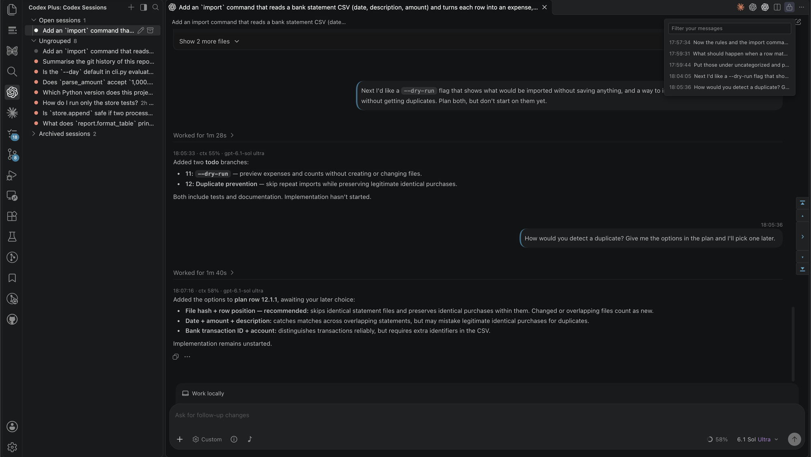

# Codex Plus

Codex Plus is a VS Code extension that adds features to Codex, OpenAI's VS Code extension (`openai.chatgpt`). It adds a work plan for each Codex conversation alongside your conversations in Agent Plus's views, and a sidebar list of Codex conversations laid out like Claude Code's list. It also adds times, a rail of your own messages, a context meter, chimes and dots on tabs to Codex's conversation page, message box and tabs, plus skill search and wake-ups for Codex itself. It depends on Agent Plus (`xnervwang.agent-plus`), which VS Code installs along with it, and it installs a work plan plugin into Codex and edits Codex's installed files.

## Getting started

1. Install Codex Plus. VS Code installs Agent Plus along with it. To install from `.vsix` files instead, see [Install](#install).
2. When Codex Plus starts, it installs the work plan plugin into Codex and edits Codex's installed files without asking. This README calls the file edit "the patch". When Codex asks whether to trust the plugin's hooks (scripts Codex runs at set points, such as when you send a message or when Codex has finished working on it), trust them. You can also do this later in Codex: Settings > Hooks. When Codex Plus offers to reload the window, reload it.
3. After the reload, you see a Codex Plus sidebar listing your Codex sessions. In a Codex conversation, you see the time above every message, a rail of your own messages at the right edge, and an information button, a note button and a context meter in the message box's toolbar. A coloured dot appears on a Codex tab's logo while its conversation is working, has a reply you have not read, or waits for your permission. Your Codex conversations also appear in Agent Plus's Work plan and Conversations views.
4. To turn things off, `Codex Plus: Turn Off` stops drawing what Codex Plus adds to Codex's page and tabs. Agent Plus's token mode (`agentPlus.tokenMode`) decides which features may add text to what Codex sends the model. Set it to Interface features to stop Codex Plus adding anything to what Codex sends the model. `Codex Plus: Remove the Patch from Codex` puts Codex's own files back. All three are in [Turning it all off](#turning-it-all-off).

`Codex Plus: Show Status` shows what is installed, what is patched and what is registered with Agent Plus.

## What it looks like

A Codex conversation, with its work plan (the task list the agent keeps for it) on the left, in Agent Plus, the extension installed with this one:


The Codex sessions list in the Codex Plus sidebar:



## Features

Most of what Codex Plus draws in Codex's page, message box and tabs needs the patch.

| Feature | Where |
| --- | --- |
| Your Codex conversations, with their work plans and the questions in them ([Work plan](#work-plan)) | Agent Plus's Work plan, Conversations and Answer views |
| A work plan for each conversation, which Codex keeps up to date and is given every turn ([Work plan](#work-plan)) | Agent Plus's Work plan view; Codex's context |
| Reminders to Codex at the end of a turn and around a compaction to keep the plan current ([Work plan](#work-plan)) | Codex's context |
| The conversation's brief: its summary and where it stands, written by Codex ([The brief](#the-brief)) | Agent Plus's Answer view |
| Answers to plan questions, sent from Agent Plus into the conversation ([Answering a plan question](#answering-a-plan-question)) | Agent Plus's Answer view; Codex's message box |
| Your time zone, told to Codex when it runs on another machine ([Your time zone](#your-time-zone)) | Codex's context |
| Images in replies: a chart or screenshot the model saves, shown in the reply, and web images shown as links ([Images in replies](#images-in-replies)) | Codex conversation; Codex's context |
| The installed skills that best fit each message, given to Codex before the turn ([Skill search](#skill-search)) | Codex's context; the line under a reply |
| Wake-ups: prompts the model schedules to keep an idle conversation going ([Wake-ups](#wake-ups)) | Codex conversations open in this window |
| A list of your Codex conversations laid out like Claude Code's, with groups, search, status dots and account usage ([The session list](#the-session-list)) | Codex sessions view, in the Codex Plus sidebar |
| Archiving and deleting conversations, and deleting old archived ones ([Archive and delete](#archive-and-delete)) | Codex sessions view |
| Pausing, resuming and clearing a conversation's goal ([Goals](#goals)) | Codex sessions view; command palette |
| A Codex button on the tab bar, dropped and closed tabs reopened, and dots and titles on Codex tabs ([Tabs](#tabs)) | Editor tab bar and tabs |
| A time on every message and reply, a rail of your own messages, your messages marked, and a Stop hook's prompt folded to one line ([In a conversation](#in-a-conversation)) | Codex conversation |
| Each reply's context share, model, effort and duration, and the tool call and commands still running ([In a conversation](#in-a-conversation)) | Codex conversation; the row below the message box |
| An information button, a chime button, a context meter that compacts on a click, and the Agent map ([The message box's toolbar](#the-message-boxs-toolbar)) | Codex message box's toolbar |
| Chimes when a turn finishes, a question waits for you, or Codex stops for your permission ([Chimes](#chimes)) | Codex tab; Codex's sidebar |
| A conversation stopped for your permission, shown as waiting ([Waiting for your permission](#waiting-for-your-permission)) | Agent Plus's Conversations view; editor tabs |
| What is installed and running, and how long Codex's pages took to open ([Show Status](#show-status)) | Command palette; Codex Plus output channel |
| The token mode, which decides which of these add to what Codex sends the model ([What it costs in tokens](#what-it-costs-in-tokens)) | Agent Plus's status bar entry |

## Work plan

Codex conversations appear in Agent Plus's Work plan, Conversations and Answer views. [Agent Plus's README](https://github.com/xnervwang/vscode-agent-plus) says what each view shows. Each conversation can have a work plan: numbered rows, each with a state. Open rows are `discussing`, `todo`, `doing`, `waiting` or `parked`; closed ones are `done` or `dropped`. Codex keeps the plan across turns (one message of yours and Codex's work on it) and compactions (when context fills up and Codex replaces the conversation so far with a summary).

Agent Plus's Work plan view shows the plan, which Codex receives with every message. Each conversation's plan is a file, `<conversation ID>.json` (the thread ID the [information button](#the-information-button) shows), in the work plan plugin's data folder, `plugins/data/agent-work-plan-codex-extras/` in Codex's home folder (`~/.codex` unless you set another).

The work plan needs the work plan plugin, which Codex Plus installs into Codex, and needs its hooks to be trusted. Codex changes rows with the plugin's `set_row` and `add_row` tools, and changes the brief with `set_summary` and `set_status`. These tools come from the plugin's MCP server, a process the plugin runs that offers Codex tools through the Model Context Protocol. Calling them needs no sandbox approval. If Codex edits the plan file directly, the edit is refused.

At the end of a turn, the plugin reminds Codex about rows left `doing` (in progress), a reply that asks you something without putting the question on a row, and a plan not brought up to date. Before automatic compaction, it reminds Codex to update `doing` rows when the context reaches 70% and 85% of the point where Codex compacts. Codex compacts at 90% of the model's context window, or at `model_auto_compact_token_limit` in Codex's `config.toml` when that is lower. After compaction, the plugin points Codex to the plan. `codexPlus.workPlanQuietWhenReplyMatches`, a regular expression, keeps these reminders quiet when the latest reply matches it, for conversations that relay another model's replies word for word.

If a conversation has no plan, Codex is offered one once, after your third message, in a turn of at least 25 tool calls. `codexPlus.workPlanOfferMinTurns` and `codexPlus.workPlanOfferMinToolCalls` set those two numbers. `codexPlus.workPlan` turns the work plan off.

### The brief

The brief is the conversation's summary and status. The work plan text sent with each message ends with a sentence asking Codex to write the status before its final reply. If a turn did work without writing the status, Codex is asked for it once at the end of that turn.

Codex is also asked for a summary when there is none, after a top-level plan row is added, removed or closed, and after compaction. Clicking the conversation in Agent Plus's Conversations view shows its brief in the Answer view. `codexPlus.conversationBrief` turns off the brief and these requests.

### Answering a plan question

Codex can put questions on rows of its work plan. You answer these plan questions in Agent Plus's Answer view. Your answer goes into the conversation's message box only when the box is empty, and is sent as Enter would send it. While a turn runs, Codex queues the answer or steers the running turn with it.

The answer goes to the conversation's Codex tab, or to Codex's sidebar when the sidebar shows the conversation. The Answer view says whether the answer was sent, left as a draft, or refused because the box held a draft of yours. This needs the patch. Without the patch, the answer stays in the Answer view.

## Your time zone

When Codex runs on another machine, the plugin tells Codex your time zone, that machine's zone and the current time. It says nothing when Codex's own page (the web page Codex draws its conversation in, in the sidebar or a tab) has told Codex the same zone since the last compaction through `<codex_apps_client_time_context>`. This needs the plugin and the patch. `codexPlus.tellCodexYourTimeZone` turns it off.

## Images in replies

Codex's VS Code panel shows images linked by absolute local paths, `file://` URLs or `data:` URLs. Relative paths do not display images. When `codexPlus.replyImages` is on (the default), the plugin sends the model a note of about 450 characters explaining that the panel shows images. It asks the model to save a PNG or SVG with an ASCII name in the conversation's folder and link to its absolute path. For a web image, it asks the model to download the file into that folder first. The folder is `$CODEX_HOME/scratch/<working directory>/<conversation ID>/`, with each character other than a letter or digit in the working directory replaced by `-`. The plugin sends the note when a panel conversation starts and after each compaction. It skips `codex exec`, terminal conversations and Codex builds that Codex Plus has not been checked against.

Whether the setting is on or off, the patch shows a web image as a plain link. The link text is the image's alt text, or its address if there is no alt text. Codex Plus does not fetch it. With a ChatGPT login, Codex checks the address with OpenAI's service and can load the image before the patch turns it into a link. Turn `codexPlus.replyImages` off and the patch shows other images as `[Image]`, with the path on hover. If it sent the note earlier in the conversation, it tells the model in the next message that the panel no longer shows images. The setting has no effect when `codexPlus.enabled` is off.

## Skill search

Before each turn, Codex Plus puts the installed skills that best fit your message in front of Codex. It includes their full descriptions and the path of each one's `SKILL.md`, under a line asking the model to check that a skill fits before reading it. The names of those skills appear on a line under that turn's reply.

Codex's own list of skills cuts every description to about 50 characters once a hundred or so skills are installed. It silently drops what its budget cannot hold (see "Codex's own list of skills" below).

Codex Plus searches these folders that Codex reads:

- The repository's `.agents/skills` and `.codex/skills`, from the working folder up to the repository's root
- `$CODEX_HOME/skills` (`~/.codex/skills` by default)
- `~/.agents/skills`
- Codex's system skills
- `/etc/codex/skills`
- The skills of every plugin that Codex's `config.toml` enables

It also searches each folder in `codexPlus.skillRoutingExtraFolders` (`~/.claude/skills` by default). It searches the Claude Code plugins named in `codexPlus.skillRoutingClaudePlugins` (none by default).

Codex Plus leaves out skills turned off in `config.toml`'s `[[skills.config]]` and skills whose `agents/openai.yaml` sets `allow_implicit_invocation: false`. It also leaves out a skill you name with `$name` in your message, because Codex puts that skill's whole `SKILL.md` in front of the model itself. Skills with the same name or description appear once, using the copy Codex reads first. Messages under six characters get no skills.

The keyword search runs on your machine and uses BM25, a standard formula for ranking text by keywords. It searches words, 4-letter pieces of words, and pairs of Chinese or Japanese characters. A skill's name weighs more than its description. Keyword search uses no network or credentials.

When skills change, the next turn notices and rebuilds the index in the background. It uses the old index until the rebuild finishes. Rebuilding 244 skills takes about a third of a second.

If Codex Plus gave a skill in full earlier in the conversation with the same description and path, it does not give it again unless the conversation has since been compacted or rolled back. In the text given to Codex, a line lists every skill the search found, best fit first, and marks those given earlier. A sub-agent, a conversation Codex starts from another conversation to do part of its work, always gets every skill in full.

To find skills already given, the hook reads what was added since the previous turn to the conversation log, the file Codex writes for each conversation (a rollout). It saves what it found in `<conversation ID>.routed` beside the plan. That file is deleted with the conversation.

Each turn costs one Python process, which Codex starts for the plugin's hook. The process compares modification times of the skill files it indexed and reads that index, about 1 MB for 250 skills. With 244 skills, it took 44 ms at the median and 53 ms at the 95th percentile, not counting Python's own start-up. The skills put in front of Codex add about 1,550 input tokens when all are new to the conversation ([Typical values](#typical-values)).

On 2026-11-16, one machine had nine Codex conversations with more than one turn, totaling 81 turns. Skill blocks used 57% of the characters they would have used if every skill were given in full on each turn.

Skill search needs the work plan plugin with its hooks trusted. `codexPlus.skillRouting` turns it off. `codexPlus.skillRoutingCount` sets how many skills are given (5 by default).

After Codex Plus updates the plugin, Codex asks once more whether to trust the plugin's hooks, because the skill search's hook is new.

### Search by meaning

Search by meaning is off unless `codexPlus.skillRoutingVectorSearch` is on. Even then, it runs only while Codex's model provider is Amazon Bedrock. It sends only your message text, up to 1,500 characters, to `cohere.embed-v4` on the Bedrock account and region Codex uses. Bedrock bills it as embedding, and it adds nothing to the conversation. It signs the request with the credentials Codex is set up with: the provider's `credential_export` command, its `profile`, or the standard AWS variables. The credentials are never written to disk.

Each skill's name and description are sent when the index is built, and again only after they change. Search by meaning uses `HTTPS_PROXY` when it is set. A turn waits at most 1.5 seconds for it, network included, and falls back to keyword search on any failure. A lasting failure (no credentials, access denied, or the model not offered in the region) turns it off for six hours, or until the provider, region, or setting changes.

### The skill_search tool

`skill_search` is a read-only tool of the plugin's MCP server. It runs the same search with words the model chooses, so the model can rephrase, try synonyms, or turn a request made in another language into English keywords.

### What is logged

`skill-route/route.log` in the work plan plugin's data folder records the skills each turn got, which were given in full or by name only, whether keyword search or search by meaning found them, how long it took, and which `SKILL.md` files the turn then read. It never records the words of a message. The log stays under 256 KB, with one older file.

### Codex's own list of skills

When `codexPlus.skillsListBudget` is not 0, Codex Plus writes it into Codex's `config.toml` as `skills.max_context_tokens`. Codex's own default is 2% of the model's context window, about 50 characters per description with a hundred or more skills. At 10,000 tokens, the most Codex takes, each description gets about 195 characters. Every turn's context then carries a skills list of up to that many tokens. The default value, 0, leaves Codex's setting alone.

`codexPlus.disabledSkills` names skills to turn off. Codex Plus writes each as a `[[skills.config]]` entry with `enabled = false`. Codex leaves the skill out of its list and does not run it when you name it with `$name`; skill search leaves it out too. Name a plugin's skill with its plugin, as `Plugin-name:skill-name`. Removing a name removes only the entry this setting added. A value you wrote into `config.toml` yourself is never changed.

## Wake-ups

A wake-up sends a message to an idle conversation every few minutes so unfinished work can continue without you. It works like Claude Code's periodic alarm. The model sets one with the work plan plugin's tool `set_wakeup` when you ask for a wake-up or before a long stretch of work. It gives the tool a prompt of up to 4,000 characters and an interval of 1 to 1,440 minutes, with 5 minutes as the default.

A conversation can have at most one wake-up; setting it again replaces the previous one. The model removes it with `clear_wakeup` when the work is done or only your decisions are left. A wake-up is also removed seven days after it was set.

Every interval, Codex Plus adds the prompt to the conversation's queue (`thread/queue/add`) over Codex's own connection to its app-server (`codex app-server`, the background process Codex starts for each VS Code window). Codex sends it when the conversation is idle, after any turn already running. Each wake-up is a message of its own and starts a whole turn, with a first line saying the wake-up sent it. A wake-up still waiting in the queue is not queued again.

Wake-ups go only to Codex conversations open in this window. A conversation open in no window is not woken; two windows with it open queue it once. If you stop a conversation's turn, its wake-up is paused and its queued prompt withdrawn until another turn starts. Nothing is sent before the patch hands over Codex's connection or while `codexPlus.wakeUps` is off. Wake-ups need the work plan plugin and the patch.

`Codex Plus: Show Status` lists the wake-ups that are set. A conversation's Agent map (see [The message box's toolbar](#the-message-boxs-toolbar)) shows its own wake-up with Remove. The work plan plugin keeps the wake-up as `<conversation ID>.wakeup` in its data folder, with `<conversation ID>.woke` beside it to record when it last fired and whether it is paused. Both files are deleted with the conversation.

## The session list

The Codex sessions view in the Codex Plus sidebar lists your Codex conversations. It follows the layout of Claude Code's list in Claude Code Plus, this extension's counterpart for Claude Code, and uses your theme's colours. `codexPlus.sessionList` hides the view.

### Sections

From top to bottom, the list shows Account & usage, Recently closed and Open sessions, each with its count. Your groups, Ungrouped and Archived sessions follow. A group you made stays visible when empty. Recently closed, Open sessions, Ungrouped and Archived sessions are omitted when empty.

Recently closed contains the conversation a tab showed when it closed, including a tab opened with a New button. It lists up to `codexPlus.recentClosedSessions` conversations. The default is 10; 0 hides the section. Open sessions includes tabs Codex opened with its own New button, whose URI names no conversation. This needs the patch.

Open sessions also lists the conversation in Codex's sidebar while the sidebar is visible. Clicking that row goes to the sidebar. It is the conversation the sidebar last went to, so while the sidebar shows its own new-conversation page, the conversation it showed before is still listed. This needs the patch. As in Claude Code's list, the conversation in front is drawn as current and scrolled to in Open sessions, without moving your focus.

### Rows

Rows are 28 px high, with an 8 px status dot, a title and the time on the right. Rename replaces the time on hover. Group names have count badges, section labels are in capitals, and New in tab and New in sidebar sit side by side.

A row shows how long ago you last used a conversation and the first and last day you used it, as `2d · 11/05→11/09`. The time uses `now`, `5m`, `3h`, `2d`, `1mo` or `1y`; dates in another year include the year, as in Claude Code's list. You can give a title a colour with Text Color (see "Menus and groups"). Hovering shows its group and session ID, as Claude Code Plus writes them.

With `codexPlus.hideBackgroundSessions` on, the default, the list omits conversations started by `codex exec`, sub-agents and approval reviews (conversations Codex starts to review an approval request). Turn it off to list them with the rest. Each sub-agent is indented under the conversation that started it, which its hover names. If that conversation is not listed, the sub-agent stays among the rest.

### Status dots

Each row's dot follows Claude Code's list, using Claude Code Plus's colours. Green means running, blue means waiting for you, and red means an unread reply or a failed last turn. Grey means idle and open in this window; otherwise there is no dot. Running or waiting in another window uses a ring of the same colour instead.

A conversation stays green while something it started is still running after its turn. Hovering names the sub-agent, Codex background command, shell detached with `setsid` or `nohup`, `codex exec` or `claude -p` worker (a one-off Codex or Claude Code run started from a command line), or `claude --bg` session (a Claude Code session started in the background). Detached shells and those workers are found through `/proc`, so detection works only on Linux.

A reply is unread if its turn ended after you last had the conversation in front of you in a focused window, either in its tab or in Codex's visible sidebar. Bringing it to the front clears the unread state in every window. Codex Plus does not use Codex's unread marks because nothing inside VS Code marks them read.

### Searching and moving rows

The filter row offers a status filter (Needs input, Working, Completed, and Open or Closed tabs, each with a count), an Active filter (needing input, working or unread), search by title, branch or four hex characters of the ID, and New group. Typing in the list starts a search. Arrow keys move through rows, Enter opens one, and Esc clears the search or selection.

Drag rows onto a group's header to move them into that group. Drag them onto Ungrouped to remove them from every group.

### Starting and resuming conversations

New in tab and New in sidebar start a Codex conversation. Resume in tab and Resume in sidebar appear only when the conversation is not open in this window, as in Claude Code Plus. The sidebar actions open Codex's own link, `vscode://openai.chatgpt/local/<id>` in this editor's scheme, and need nothing else. [Tabs](#tabs) covers where New in tab opens its tab.

### Account & usage

Account & usage sits at the top, as it does in Claude Code's list. It shows how Codex is signed in: Amazon Bedrock, an API key, or a ChatGPT account's email and plan. Only when Codex provides the figures does it show each rate limit's share used and reset time, and tokens spent today and in total.

When the list comes into view, Codex Plus asks this window's app-server for the information, at most once a minute. It then uses notifications Codex sends anyway to keep it current. This section needs the patch and is hidden without it.

### Menus and groups

Codex Plus draws the row's right-click menu in the look of Claude Code's own. It has Rename (also available on hover), Text Color and Add to Group (submenus opening to the right, as in Claude Code Plus), Remove from Group, Mark as Unread or Mark as Read, and Archive. Every one of them but Rename acts on all the selected rows.

A group's header offers Start New Session in This Group, New Group, Rename Group and Delete Group. A conversation started in a group moves into it after its first message is sent, when Codex lists it. Groups are Codex's own sections, but Codex Plus keeps their order because Codex keeps none. Codex's built-in Pinned section is never offered as a group to add to.

Every action here except Mark as Unread and Mark as Read goes to this window's app-server over Codex's own connection. Before the patch takes effect, it goes to a short-lived app-server Codex Plus starts instead. Mark as Unread and Mark as Read change only Codex Plus's record of what you have read.

### Archive and delete

Archived sessions is the last group and stays collapsed until you open it. It lists this workspace's conversations archived from the list or Codex itself, most recently archived first. Archive works whether the conversation is open or not, as in Claude Code's list. Codex moves its log to `archived_sessions/` and archives its sub-agents with it. A conversation that is running, or has a running sub-agent, is not archived because Codex would stop its turn.

An archived row's menu has Resume in Tab, Resume in Sidebar, Text Color and Unarchive. After a separator it has Delete, which no other row has. Delete asks first and says that Codex will delete the conversation log and its sub-agents' logs. A conversation open in this window or running is not deleted.

Once a day, one of your windows deletes conversations archived at least `codexPlus.deleteArchivedAfterDays` days ago in the same way, without asking. The default is 30 days; 0 keeps them. The output channel "Codex Plus" lists what was deleted. Days count from Codex's archive time, or from when Codex Plus first saw an archived conversation if Codex recorded no time. An open or running conversation is left for the next day.

### Goals

A conversation's goal is something Codex works toward on its own. It starts another turn whenever the conversation is idle, until the goal is done, blocked or out of its token budget. To set one, ask Codex for a goal in the conversation. The row shows `goal`, `goal paused` or `goal: budget spent`; hovering shows the goal and tokens used from its budget.

Pause Goal, Resume Goal and Clear Goal are in the row's right-click menu and in the command palette for the conversation in front. Resume Goal lets the goal start turns again, using Codex's own model calls. Each change is sent as yours to this window's app-server on Codex's own connection. Before the patch takes effect, it goes to a short-lived app-server Codex Plus starts.

### Not in this list

Three things in Claude Code's list are not in this one:

- Usage for an Amazon Bedrock account, and money: for Amazon Bedrock, Codex returns an error to `account/rateLimits/read`, as its own `/status` reports "Rate limit: Unavailable", so Account & usage shows only how Codex is signed in. No price or balance is shown for any account.
- Local / Web switches between Claude Code's own sessions and cloud sessions. Codex's cloud tasks come from ChatGPT's servers, which this list does not read.
- Pinning keeps Claude Code's own clean-up from archiving a session idle for 14 days. Codex archives nothing on its own, and Codex Plus deletes only archived conversations. A conversation pinned in Codex's desktop app is in Codex's built-in Pinned section, which this list shows as a group while it holds something.

## Tabs

The Codex button on the editor's tab bar and New in tab in the session list open a new Codex conversation in a tab. They use an editor group holding only Codex tabs if one exists, otherwise a group holding any Codex tab, otherwise the first group (the main editor area). They never open a new split.

With the patch in effect, the tab bar shows Codex Plus's button instead of Codex's own. It opens what `codexPlus.tabBarButton` specifies: `tab` by default, or `sidebar`. Its hover says *New Codex Conversation in a Tab* or *Open Codex Sidebar* to match. VS Code takes that hover from the command's title in the extension's `package.json`, so the patch adds a condition to Codex's `package.json` that hides Codex's button while this extension's is shown. The button appears once the window has been reloaded after the patch is written.

Codex Plus reopens tabs that VS Code did not restore after a reconnect. The status bar reports how many for ten seconds, as Claude Code Plus does. `codexPlus.reopenDroppedTabs` turns this off. Ctrl+Shift+T (Cmd+Shift+T on a Mac) reopens the last closed Codex conversation while the last closed tab was a Codex tab, as Claude Code's shortcut reopens its last session. After any other tab, it runs VS Code's Reopen Closed Editor. `codexPlus.reopenClosedSessionShortcut` turns this off.

A Codex tab's logo gets a dot in Claude Code Plus's colours and size: green while the conversation is working or something it started is still running, red for a reply you have not read, and blue while it waits for your permission. The tab's title follows Codex's conversation name, including for a conversation started in a tab. Its right-click menu has Rename, Mark as Unread and Add to Group, as Claude Code's tab has its three; Add to Group opens a list at the top of the window. The dots, titles and tab bar button need the patch.

## In a conversation

Codex Plus draws these additions into Codex's own page. Each needs the patch and a window reload, because the page keeps running the script it was built with.

The time appears above every message and reply block in your own time zone, including a message you send while a turn runs. It replaces Codex's time below a reply and beside your message. A time read from the conversation log includes seconds (`HH:MM:SS`); one read from the clock Codex shows on its page has only `HH:MM`. Messages from another day start with `MM/DD HH:MM:SS`, or include the year (`YYYY/MM/DD`) if it is not this year. `codexPlus.timestamps` turns the times off.

Beside each reply's time, you see that turn's share of the context window (see [The context meter](#the-context-meter)), model and effort, for example `14:02:11  ctx 33% · gpt-6.1-sol high`. Codex Plus matches them by the turn ID Codex puts on the reply; `codexPlus.turnFigures` turns them off. When Codex shows no "Worked for" of its own, the time also includes the turn's duration, for example `14:02:11  9s · ctx 33% · …`. Codex draws "Worked for" only when a turn did something before its reply. `codexPlus.replyDuration` turns the added duration off.

The rail at the right edge lists your messages by time and opening words, along with where Codex compacted the context. Click a row to scroll to it, step with the arrow keys or `,` and `.`, filter, or jump to the top or bottom. As in Claude Code Plus, the list is 280 px wide and shows 44 characters per row. The opening words are read and shown in the page, not sent anywhere. `codexPlus.conversationNavigation` turns the rail off.

Resting on a rail row shows its time and first 220 characters together in a box beside the list. Every rail button has its own explanatory box. After a jump, the view stays on the message for about a second while Codex's turns still move. A wheel, touch or key releases it.

Your messages have a bar down their leading edge in the theme's focus colour. `codexPlus.userMessageEdge` turns the bar off. `codexPlus.userMessageColor` sets their text colour to a CSS colour such as `#90EE90`, `lightgreen` or `rgb(144,238,144)`. An empty value, the default, keeps Codex's colour.

A Stop hook can prompt Codex to continue a turn. Its bubble appears on your side with "Hook feedback" underneath. Codex Plus folds it to one dim line. It drops the bubble background and skips your message bar and text colour. Folding has no separate setting. Click the line to show the whole prompt, then click it again to fold it.

Codex Plus adds a row below the message box. At its right end, it shows the tool call running now, such as `exec_command running for 2m55s (since 11:11:18)`, while Codex's row for that call is out of view. When Codex's row is in view, it already says this. The same place counts commands Codex started that are still running, such as a build or a `sleep` left in the background, until Codex reports that the process ended.

`Codex Plus: Show Status` lists each still-running command, when it started and which conversation it belongs to. Codex Plus sees only this window's Codex. If you reload the window while a command runs, it learns of that command only when it ends. `codexPlus.turnFigures` turns off the tool-call display and command count too.

How the page script (the script Codex Plus adds to Codex's page) reads the times and what it changes there is in [docs/codex-page.md](docs/codex-page.md#inside-a-codex-conversation).

## The message box's toolbar

Codex Plus puts four controls in Codex's toolbar row in the message box. The information and note buttons follow Codex's permissions button. The context meter sits left of the model picker, where Codex puts its own meter. The Agent map sits right of the context meter. The note button is described under [Chimes](#chimes).

The controls look like Codex's buttons because they take CSS classes read from the page: the two icons use the add-context button's classes, and the meter uses the permissions pill's. Pressing a control leaves the caret in the message box, and its click reaches nothing else on the page. The controls enter the toolbar only after the model picker shows the model's name. If the row is full when Codex lays out that name, Codex draws the picker as a bare icon and keeps it that way.

The controls go to the row Codex Plus adds below the message box (see [In a conversation](#in-a-conversation)) when they do not fit, move the model picker, or hide more of the model's name. They try the toolbar again only when it has room for them plus 24 pixels. This keeps them from moving back and forth when you resize near the edge. Once back in the toolbar, they leave it if room runs out, the picker loses its name, or more of the name becomes hidden than when they entered. They stay in the toolbar when the model picker would cut a long model name just as much if the controls were not there. None moves while your pointer is on a control or a box it opened.

### The information button

The information button shows the conversation's thread ID, this window's Codex app-server process ID, folder, conversation log and its size, context window use, tokens used, account and token mode. Click a value to copy it. `codexPlus.infoButton` hides the button. It needs the patch.

### The context meter

The meter shows a ring and the share of the context window in use. Codex's meter is hidden while this one is drawn, leaving one reading in the row; it returns when `codexPlus.contextMeter` is off. Hover to see which context window it uses and where that figure came from (`codexPlus.contextWindow`, below, can set it), tokens in use and free, where Codex compacts and how far away that is, conversation input, cached input, output and reasoning tokens, and the model and effort. You also see how many times the work plan has added context since the last compaction, how many characters those additions came to, and about what share of the context in use that is. The meter needs the patch.

Codex's meter and this one can differ: Codex divides the last model call's input and output by the context window; this meter divides input alone, as the figures beside replies and the work plan plugin's compaction reminders do. This meter reads figures from the conversation log every 3 seconds, while Codex's follows the app-server live. `codexPlus.contextWindow` gives each listed model its own window, up to `1.05M` for GPT-6 models, using OpenAI's published window including output. Codex caps GPT-6.1 Sol's input at 872K. An already loaded conversation keeps its old window until you reload the VS Code window; without the patch, the setting applies only to the default `model` in `config.toml`.

Clicking the meter starts a compaction now by sending `thread/compact/start` to this window's app-server. Codex's `/compact` sends the same request. The compaction appears in the conversation and counts as one of Codex's own model calls. Codex offers `/compact` only when the message box is empty; the meter does not touch the box, so your draft stays. While a turn runs or an approval waits, the click is refused, as Codex refuses `/compact` then: "Compact is disabled while a chat is in progress".

Codex compacts at 90% of the model's full window, or at `model_auto_compact_token_limit` in `config.toml` if lower. The meter counts against the window Codex reports, which is 95% of the full one, so Codex compacts when the meter reads about 94.7%. Once the meter reads 80% or more, 15 points before that, an outline appears, as Claude Code Plus outlines its meter 15% before compaction. When this extension's meter is not drawn, the outline goes on Codex's meter, which Codex draws only when you turn on General, Composer, Show context window usage in Codex's settings. `codexPlus.lowContextOutline` turns the outline off.

### The Agent map

The Agent map is a pill like Claude Code's, reading for example `2 agents · 1 timer · goal`. It appears while the conversation has a wake-up (the timer), a goal or sub-agents. It needs the patch.

Click it to open a dialog with a section for each. A wake-up shows its interval, next time, end and prompt, with Remove. A goal shows its state and tokens, with Pause, Resume and Clear. Each sub-agent shows a status dot and when it was last active; click it to open it in a tab. Esc or a click outside closes the dialog.

## Chimes

Codex Plus chimes when a turn finishes, when the model asks you something and waits for your answer (a blocking input request), and when Codex stops for your permission. The three sounds are Claude Code Plus's own: rising for a finished turn, falling for a question, and three equal notes for permission. The sound plays in the page showing the conversation: a Codex tab in this window or Codex's sidebar while it shows the conversation. If both show it, only the tab rings.

The note button beside the information button in the message box's toolbar turns chimes on and off. It is struck through while chimes are off. `codexPlus.chime` turns chimes off; `codexPlus.chimeButton` hides the note button without changing `codexPlus.chime`. Chimes need the patch.

## Waiting for your permission

A conversation stopped for your permission shows as waiting in Agent Plus's Conversations view, puts a blue dot on its tab, and chimes. This needs the patch. Codex asks its client for approval in a request but does not save that request in its own files. Codex Plus reads requests passing through this window's extension host (the process VS Code runs extensions in), which the patch hands over, and reads the approval card on a Codex page.

Only requests that wait indefinitely count as waiting. These include the three `requestApproval` methods (for a command, a file change, and permissions), the older `execCommandApproval` and `applyPatchApproval` methods, a blocking input request, and an input request from an MCP server (an elicitation) for which Codex set no countdown. Requests Codex answers itself when a countdown runs out do not count. That usually happens within 90 seconds, with an empty input or a declined elicitation.

A wait ends when this window sends the answer or a notification says somebody else answered it. If neither happens, it ends when two Codex Plus polls in a row find that the conversation's turn is no longer running. A conversation shown in neither a tab nor the sidebar still shows as waiting in the Conversations view and is counted there. It makes no sound.

Codex Plus cannot see requests from:

- Another VS Code window: each window starts its own app-server, and its requests go to that window's extension host.
- `codex exec` (Codex run from the command line for one task, outside VS Code): it runs in a separate process with no extension host, so nothing in VS Code sees its requests. Its conversation is not in the Conversations list either.

How the page finds the approval card is documented in [docs/codex-page.md](docs/codex-page.md#the-approval-card).

## Show Status

`Codex Plus: Show Status` writes to the Codex Plus output channel and shows:

- What is installed, what is patched, and what is registered with Agent Plus.
- The token mode and which of the five features that add to Codex's context run (the five are listed under [What it costs in tokens](#what-it-costs-in-tokens)).
- Whether the additions are turned off, the patch was removed, or the plugin is installed but not loaded.
- Whether this release was checked against the installed Codex build.
- Whether Python is missing, and which commands were tried to find it (see [Python](#python)).
- The wake-ups that are set.
- Commands Codex started that are still running, when each started, and which conversation it belongs to.
- The last three times a Codex page opened and how long each took.
- At the end, what the page script found in the Codex page in front, explained in [docs/codex-page.md](docs/codex-page.md#checking-what-the-page-found).

`Codex Plus: Show How Long Opening a Codex Page Took` shows how long each Codex page, in the sidebar or a tab, took to open. It shows how long it took to run Codex's page script, show the first screen, show the conversation or home page, and restore the conversation. It also shows which pages gave up. This command reads Codex's own log, `Codex.log`, in every window's log folder. It needs nothing else.

## What it costs in tokens

In an ordinary turn without a work plan, Codex Plus adds about 700 tokens to what Codex sends the model; with a work plan, it adds about 800 to 1,200 tokens. Nearly all of the 700 tokens are skill search. The plan adds about 90 tokens to a message when it has not changed since the previous message, which is about half of all messages, and about 520 tokens (the median) when it has changed. These figures count the text itself; how they were measured is under [Typical values](#typical-values).

A request at the end of a turn (an end-of-turn reminder or one of the brief's requests, under [Added now and then](#added-now-and-then)) has a separate cost: Codex answers it with two more model calls that each send the whole context again, and those calls are not included above. The work plan's text, given at the start of the turn, asks for the status before the final reply, so Codex sends the `set_status` call with the turn's other tool calls.

| Feature | Interface features | Essential features | All features | Custom |
| --- | --- | --- | --- | --- |
| Work plan | Off, plugin not loaded | On | On | `codexPlus.workPlan` |
| Time zone | Off | On | On | `codexPlus.tellCodexYourTimeZone` |
| Conversation brief | Off | Off | On | `codexPlus.conversationBrief` |
| Skill search | Off | Off | On | `codexPlus.skillRouting` |
| Wake-ups | Off | Off | On | `codexPlus.wakeUps` |
| Detached command notices | Off | Off | On | `codexPlus.detachedEndNotices` |

Codex Plus follows Agent Plus's `agentPlus.tokenMode` setting, which defaults to All features. Outside Custom, the six settings in the table's Custom column have no effect. Changing modes does not change them. Changing one of those settings outside Custom shows a notice with a Switch to Custom button.

In Interface features, Codex does not load the work plan plugin, just as when you run `Codex Plus: Stop Loading the Work Plan Plugin`. Choosing another mode loads it again unless you stopped loading it yourself. Changes to plugin loading, the work plan skill in Codex's skill list, and the `work_plan` tools (see Sent with every call) apply only to conversations started after the mode change.

In a running conversation, a mode change applies from the next message to work plan injection and reminders, conversation brief requests, the time zone, skill search, and wake-ups. `Codex Plus: Show Status` shows the mode and which of the five features run. The information button in a conversation's message box names the mode.

The tables below show the text Codex Plus adds to what Codex sends the model. All of it comes from the work plan plugin Codex Plus installs into Codex; what Codex Plus draws in VS Code sends nothing to the model. Text added to a conversation stays in context and goes with every later model call until compaction replaces the conversation with a summary. A token is about four characters of English.

### Added to every message

| What | When | At most | Turned off by |
| --- | --- | --- | --- |
| The work plan | Each message, while the conversation's plan has a row that is not `done` or `dropped`. The whole block, with what the states mean and how to change a row, on the conversation's first message and the first after each compaction; a short head in its place otherwise; one line when no row has changed since the message before | 6,000 characters, the brief included; the one line is about 160 characters and the plan's path (240 with the brief on) | `codexPlus.workPlan` |
| Skill search | Each message of six characters or more | 15,000 bytes | `codexPlus.skillRouting`; `codexPlus.skillRoutingCount` sets how many skills |

### Added now and then

| What | When | At most | Turned off by |
| --- | --- | --- | --- |
| End-of-turn reminders | At the end of a turn that left rows `doing`, asked you something without putting the question on a row, or changed things without reading or updating the plan | About 2,400 characters when every reminder and both of the brief's requests come at once, plus the plan's path, which appears four times in that text | `codexPlus.workPlan` |
| The brief's requests | The work plan's text on each message ends with one sentence asking Codex to write the status before its final reply. At the end of a turn: the status once per turn, after a turn that did work without writing it; the summary when there is none, after a top-level row was added, removed or closed, and after a compaction | The sentence counts toward the work plan's limit; the rest counts toward the end-of-turn reminders' limit above | `codexPlus.conversationBrief` |
| No row `doing` | At most once per turn, when the turn has started working and no row is `doing` | About 460 characters and the plan's path | `codexPlus.workPlan` |
| Before a compaction | At 70% and 85% of where Codex compacts, once each between compactions | About 850 characters and the plan's path | `codexPlus.workPlan` |
| After a compaction | Once per compaction | About 970 characters, the plan's path, and the path of its closed rows when it has any | `codexPlus.workPlan` |
| The offer of a plan | Once, in a conversation with no plan, after your third message, in a turn of at least 25 tool calls | About 480 characters and the plan's path | `codexPlus.workPlan`; `codexPlus.workPlanOfferMinTurns`, `codexPlus.workPlanOfferMinToolCalls` |
| A direct write to the plan, refused | When the model edits the plan file instead of using the tools | About 310 characters | `codexPlus.workPlan` |
| Your time zone | When Codex runs on another machine and its page has not told it the same zone since the last compaction | About 310 characters | `codexPlus.tellCodexYourTimeZone` |
| Images in replies | In Codex's VS Code panel, when a conversation starts and after each compaction, while `codexPlus.replyImages` is on and Codex Plus has been checked against the installed Codex; once on the next message after it is turned off, if the conversation was told | About 450 characters, the conversation's folder included; 68 characters for the sentence after it is turned off | `codexPlus.replyImages` |
| A wake-up | Every interval while one is set, as a message of its own, so a whole turn | The prompt the model set, up to 4,000 characters, every 1 to 1,440 minutes, for 7 days | `codexPlus.wakeUps`; `clear_wakeup` |

- The work plan, the skill search and the wake-up prompt are cut or refused at those sizes by the plugin. The reminders have no cut: each is fixed text with at most six row titles of 60 characters.
- Rows closed more than a day ago are moved out of the plan file to `closed/<thread id>.json` beside it, so reading the plan after a compaction costs less too; Agent Plus's views read both files.

### Sent with every call

| What | When | At most | Turned off by |
| --- | --- | --- | --- |
| The work plan skill in Codex's list of skills | Every call | Its name and a 573-character description, which Codex shortens to fit the list's budget | `Codex Plus: Stop Loading the Work Plan Plugin`, or the Interface features token mode |
| The `work_plan` MCP server's seven tools | Codex 0.167 finds MCP tools through its tool search, so their definitions join the context once a search returns them | 8,631 characters for all seven | `Codex Plus: Stop Loading the Work Plan Plugin`, or the Interface features token mode |
| Codex's own list of skills, when `codexPlus.skillsListBudget` is not 0 | Every call | That many tokens | `codexPlus.skillsListBudget` at 0, the default |

### Costing nothing

- Everything Codex Plus and Agent Plus draw in VS Code.
- The exceptions are two actions in VS Code that start Codex's own model calls: clicking the context meter compacts the conversation, and Resume Goal lets the goal start turns.
- The search by meaning, off by default, sends your message to `cohere.embed-v4` on Bedrock: billed there as embedding, nothing added to the conversation.
- Hovering the context meter shows, for the conversation in front, how many times the work plan was added since the last compaction, how many characters that came to, and about what share of the context in use.

### Typical values

Measured on 2026-11-16 on one machine, with the hooks in this repository. Tokens are estimated: a Chinese, Japanese or Korean character counts as one token, any other character as a quarter of one.

| What | Typical | How it was measured |
| --- | --- | --- |
| The work plan, whole block | Median 3,280 characters, 90th percentile 5,300 | The 46 plans with open rows among the 84 written on that machine in the 14 days before; each was copied and put through the work plan plugin's hook that adds the plan to a message, once. 44 of them are Claude Code plans, which go through the same hook; the two Codex plans gave 2,672 and 3,830 characters |
| The work plan, short head | Median 1,416 characters (about 520 tokens), 90th percentile 3,584 | The same plans, with one row added; the two Codex plans gave 808 and 1,958 characters |
| The work plan, one line | 343 characters (about 90 tokens), 102 of them the plan's path | The same plans, with the brief on |
| Messages whose plan is unchanged since the message before | 50% | 2,773 messages with the plan in 32 Claude Code conversations, from 2026-11-11 22:40 to 2026-11-16 01:12 UTC, counted as unchanged when the hook gave the one line, which it does when the rows differ only in how long each has been in its state (the plan text shows that time) |
| Skill search, every skill new to the conversation | Median 3,880 characters, about 1,550 tokens | 740 real messages, each as the first of its conversation, of which 700 got skills; 248 skills, keyword search |
| Skill search, per turn | Median about 690 tokens (1,869 characters); given in full every turn, about 1,290 | The 81 turns of the nine Codex conversations with more than one turn, in order, with skills given earlier named instead of given again |

## CPU and disk

In the background, Codex Plus checks every 3 seconds whether Codex's files have changed. About every 12 seconds, it scans the machine's processes (`/proc`, so on Linux) for work a conversation started that is still running after its turn. VS Code windows on one machine share a scan: a window uses one another window wrote less than 9 seconds ago instead of scanning itself. If a conversation log has not changed since the last read, it is skipped.

The table below shows single operations measured in isolated runs on one machine on 2026-11-15. Each result is the median of 12 runs.

| What | How often | CPU | Read |
| --- | --- | --- | --- |
| Checking whether Codex's files changed, when none did | Every 3 seconds | 0.23 ms | 105 bytes |
| Scanning processes for work left running | About every 12 seconds | 38.5 ms; 45 ms when it also writes the shared result | 0.49 MB |
| Using the scan another window wrote | In place of a scan | 0.07 ms | 258 bytes |
| Reading the conversations, with the five largest open in tabs | When a file changed | 92 ms the first time, then 0.6 to 1.5 ms while those files do not change | 28.8 MB the first time, then about 100 bytes |

Turning `codexPlus.enabled` off stops the process scan. The 3-second check keeps running because the session list and Agent Plus's views use it. To stop that check too, disable Codex Plus in VS Code's Extensions view.

## Install

Agent Plus (`xnervwang.agent-plus`) is a dependency. VS Code installs it from the marketplace along with this extension; when it is not on the marketplace, install its `.vsix` first, then build this extension from a clone of this repository and install it:

```sh
code --install-extension xnervwang.agent-plus-<version>.vsix
bash build/pack.sh
code --install-extension build/xnervwang.codex-plus-<version>.vsix
```

- In a Remote SSH window, install both on the remote.
- At start-up the work plan plugin is installed into Codex and Codex is patched, without asking, as Claude Code Plus does with Claude Code. Trust the plugin's hooks when asked (or in Codex: Settings > Hooks), and reload the window when asked.
- In Restricted Mode nothing is installed into Codex, Codex is not patched, no file is written, and no archived conversation is deleted.

### After an update of this extension

A new build of Codex Plus usually changes what the patch writes into Codex, leaving an older copy in Codex's files. Codex reads `out/extension.js` and `webview/index.html` when its extension starts and when it builds a page. VS Code reads Codex's `package.json` when a window loads. A reload helps only after the new copy is written. A few seconds after Codex Plus starts, it writes the new copy over the old one and offers a reload. You only need to click that reload.

The patch is written once, into the Codex that every window on this machine loads. Only the window that wrote it offers a reload. If Codex was already running in another window, that window offers a reload once, the next time it gets focus. Until then, it runs Codex's own code without this extension's additions.

At start-up, what happens depends on the state of Codex's files:

- This build's patch: nothing happens.
- An older build's patch: it is written over without asking, then a reload is offered.
- Codex's own files, never patched: they are patched without asking, then a reload is offered.
- Codex's own files after `Codex Plus: Remove the Patch from Codex`: they stay untouched until you run `Codex Plus: Turn On` or `Codex Plus: Toggle On/Off` to put the patch back. Codex Plus remembers the removal, as Claude Code Plus remembers its own Remove.

Codex ships a new build about every week. `Codex Plus: Show Status` tells you whether this release of Codex Plus was checked against your installed Codex build. An unchecked build is still patched if every place the patch edits is found. If one is not found, the patch leaves Codex untouched and the status says so. A warning also says that this Codex version is not supported yet, in VS Code's display language (English, Simplified Chinese or Traditional Chinese); its Show Details button runs `Codex Plus: Show Status`.

### Turning it all off

`Codex Plus: Turn Off`, `Codex Plus: Toggle On/Off`, and `codexPlus.enabled` stop drawing the times, rail, colouring, chimes, buttons, context meter in the message box's toolbar, row below the message box, and dots on tab logos. Codex is not patched or kept patched, but a patch already applied stays in Codex's files. Turning the additions off does not change their settings. Your choices return when you turn them back on.

`Codex Plus: Remove the Patch from Codex` restores Codex's `out/extension.js`, `webview/index.html` and `package.json`. Uninstalling this extension also restores those files. Reload the window afterwards.

The Interface features token mode, set with `agentPlus.tokenMode` or from Agent Plus's token mode entry in the status bar, makes the work plan, skill search, brief, time zone and wake-ups add nothing. Codex is set not to load the plugin, as with Stop Loading. Any other mode loads it again unless you stopped loading it yourself.

`Codex Plus: Stop Loading the Work Plan Plugin` keeps the plugin, its marketplace entry and the trust you gave its hooks. It sets `enabled = false` under `[plugins."agent-work-plan@codex-extras"]` in `config.toml`, so Codex does not load it. Run `Codex Plus: Install the Work Plan Plugin into Codex` to load it again; the install at start-up does not do that. Uninstalling this extension instead removes all three, as described next.

Uninstalling this extension puts Codex's own files back in this editor's extensions folder and in the extensions folder of any other editor that no longer has this extension. Once no editor on the machine has it, the work plan plugin is removed from Codex too. The plans are first copied to `agent-work-plan-plans-<time>` under `CODEX_HOME` (Codex's home folder, `~/.codex` unless you set it). If Codex Plus could not remove the plugin, the plugin stops doing anything once VS Code has deleted the folder where VS Code keeps this extension's data: on each run the plugin checks whether that folder still exists.

Notes on settings and status:

- The work plan and Codex session list have their own settings, `codexPlus.workPlan` and `codexPlus.sessionList`. `Codex Plus: Turn Off` and `codexPlus.enabled` do not cover them.
- `codexPlus.workPlan`, `codexPlus.workPlanOfferMinTurns`, `codexPlus.workPlanOfferMinToolCalls`, `codexPlus.workPlanQuietWhenReplyMatches`, `codexPlus.conversationBrief` and `codexPlus.tellCodexYourTimeZone` are user settings only. Every window and every `codex` run reads them from one file under `CODEX_HOME`; VS Code ignores their workspace or folder values.
- Turning the additions on or off shows no notification, as in Claude Code Plus. After `Codex Plus: Remove the Patch from Codex`, `Codex Plus: Turn On` and `Codex Plus: Toggle On/Off` put the patch back and offer a reload.
- `Codex Plus: Show Status` shows when additions are off, the patch is removed, or the plugin is installed but not loaded.

### Python

The work plan plugin's hooks and MCP server need Python 3.7 or later. On Windows, the install tries `py -3`, `python` and `python3` in that order; elsewhere, it tries `python3` then `python`. It writes the first one that answers into the installed plugin. Each install starts fresh, so it can find Python if you installed it since the last one.

If no Python is found, the plugin is installed without its hooks, MCP server or skill (the instructions that tell Codex how to use the work plan). The work plan then stays empty, and no turn runs a hook that would fail. A line above the plan in Agent Plus's Work plan view, and `Codex Plus: Show Status`, report the missing Python and the commands tried. As in Claude Code Plus, that line shows the problem to fix first: an installation failure (click to retry), missing Python (click to download it or install again), or untrusted hooks (click to trust them). The line goes once that problem is fixed.

On Windows, clicking that line fetches python.org's embeddable build (11 MB) into this extension's own storage, checks it against a recorded SHA-256, and installs the plugin again. The download is also offered once per version of that build at start-up, as Claude Code Plus offers it. It does not install anything system-wide. It fetches nothing before you press a button.

Elsewhere, install Python 3 and click the line, or run `Codex Plus: Install the Work Plan Plugin into Codex`. python.org publishes an embeddable build for Windows only.

## For developers

How Codex Plus is checked against each new Codex build, and the render check that draws Codex's real page with this extension's script in it, are in [CONTRIBUTING.md](CONTRIBUTING.md). How the script this extension adds to Codex's page finds what it draws on, and how to see what it found, are in [docs/codex-page.md](docs/codex-page.md).
