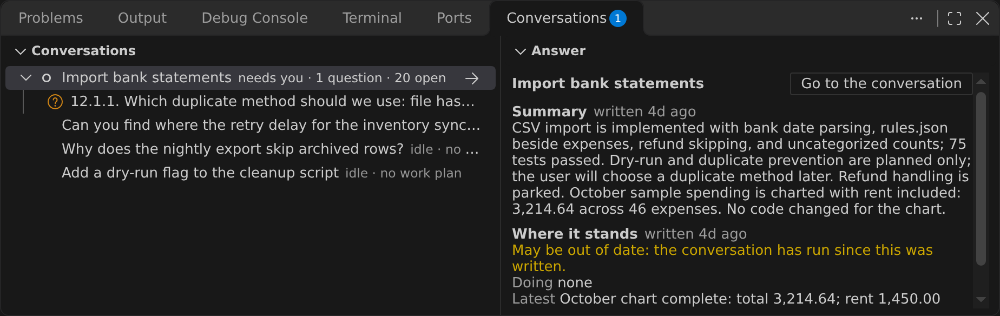
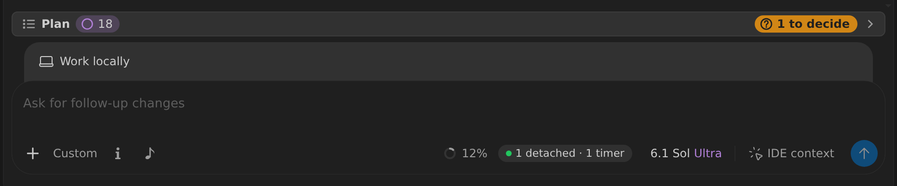
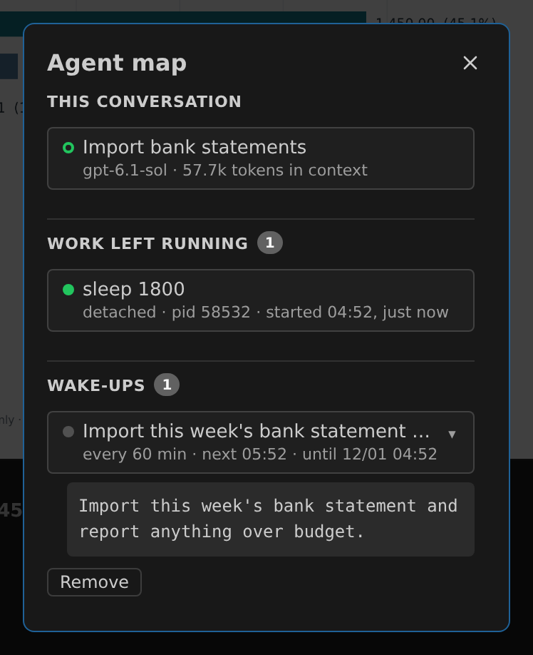
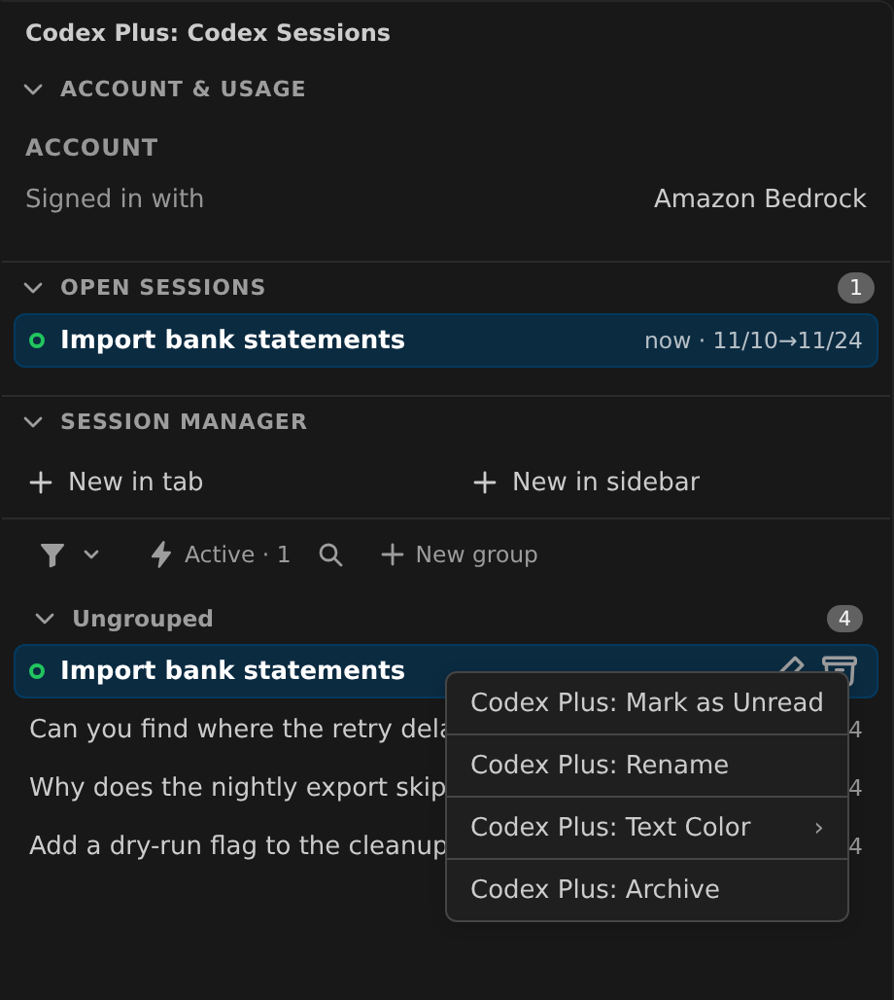
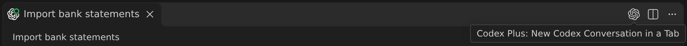
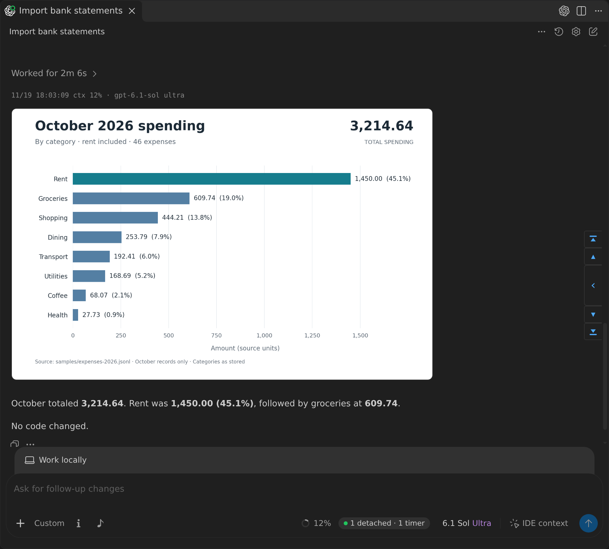
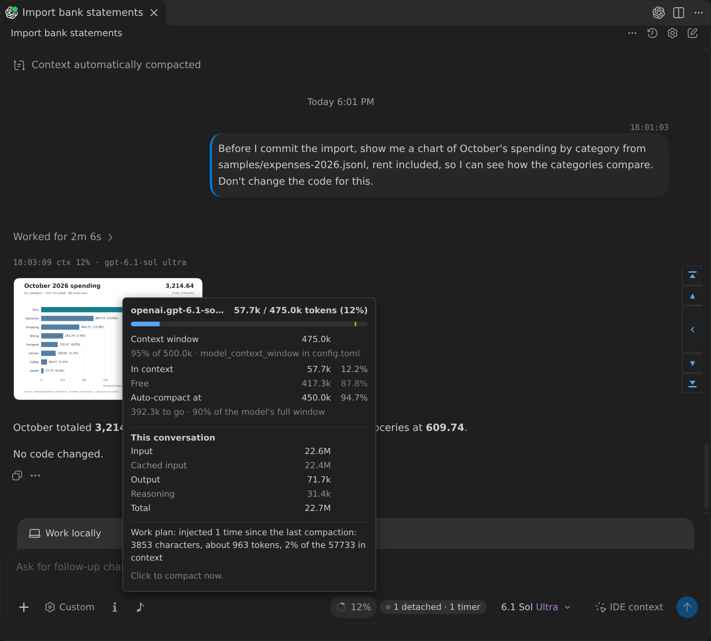
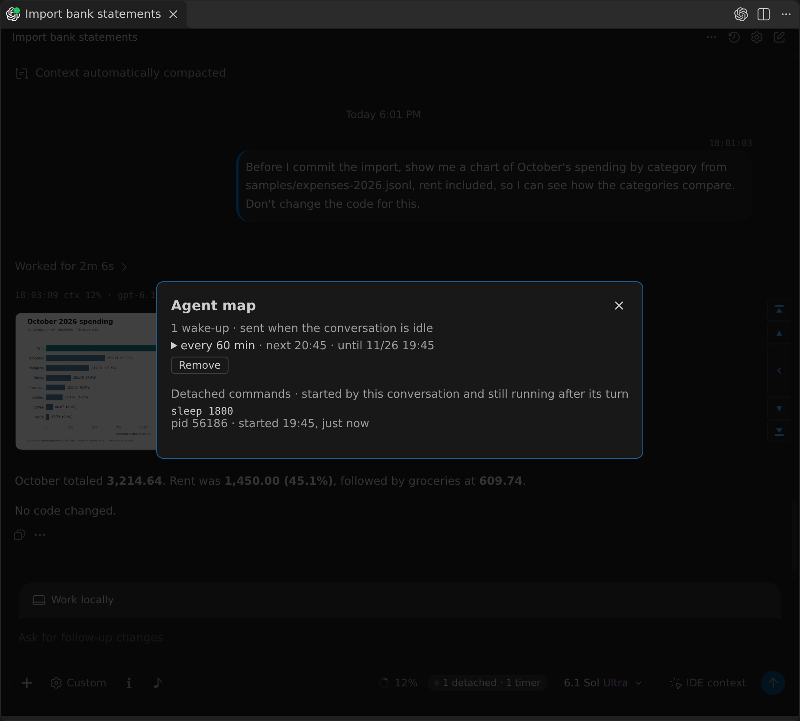
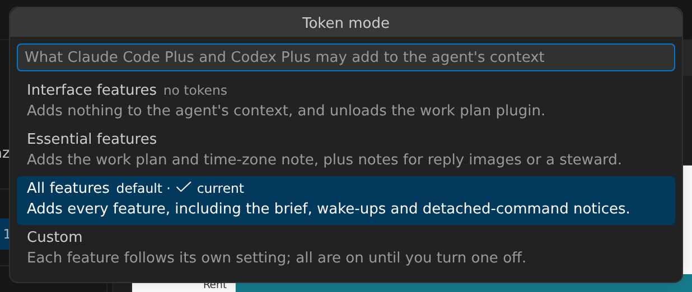

# Codex Plus

Codex Plus is a VS Code extension that adds a [work plan](#work-plan) for each conversation to the views of Agent Plus (its companion extension), a [sidebar list of conversations](#the-session-list) laid out like Claude Code's list, and [times](#times-and-turn-figures), a [rail of your own messages](#the-rail-of-your-messages), a [context meter](#the-context-meter), [chimes](#chimes-and-waiting-for-your-permission) and [tab dots](#tabs) to the conversation page, message box and tabs in Codex, OpenAI's VS Code extension (`openai.chatgpt`).

## Getting started

1. Install Codex Plus. VS Code installs Agent Plus along with it. To install from `.vsix` files instead, see [Install](docs/install.md#install).
2. When Codex Plus starts, it installs the work plan plugin into Codex and edits Codex's installed files without asking. This README calls the file edit "the patch". When Codex asks whether to trust the plugin's hooks (scripts Codex runs at set points, such as when you send a message or when Codex has finished working on it), trust them. You can also do this later in Codex: Settings > Hooks. When Codex Plus offers to reload the window, reload it.
3. After the reload, you see a Codex Plus sidebar listing your Codex sessions. In a Codex conversation, you see the time above every message, a rail of your own messages at the right edge, and an information button, a note button and a context meter in the message box's toolbar. A coloured dot appears on a Codex tab's logo while its conversation is working, has a reply you have not read, or waits for your permission. Your Codex conversations also appear in Agent Plus's Work plan and Conversations views.
4. To turn things off, `Codex Plus: Turn Off` stops drawing what Codex Plus adds to Codex's page and tabs. Agent Plus's token mode (`agentPlus.tokenMode`) decides which features may add text to what Codex sends the model. Set it to Interface features to stop Codex Plus adding anything to what Codex sends the model. `Codex Plus: Remove the Patch from Codex` puts Codex's own files back. All three are in [Turning it all off](docs/install.md#turning-it-all-off).

`Codex Plus: Show Status` shows what is installed, what is patched and what is registered with Agent Plus.

## Features

Most of what Codex Plus draws in Codex's page, message box and tabs needs the patch.

### Work plan

Agent Plus's Work plan view shows a conversation's [work plan](docs/work-plan.md) as numbered rows with states such as `todo`, `doing`, `waiting` and `done`. Codex receives the plan with every message. The work plan plugin gives Codex tools to update the plan and reminds it to do so at the end of a turn and around compaction.

### The brief and plan questions

Codex writes a [brief](docs/work-plan.md#the-brief) for each conversation with a summary and status. Click a conversation in Agent Plus's Conversations view to see its brief in the Answer view. Use the Answer view to [answer a question](docs/work-plan.md#answering-a-plan-question) Codex has put on a plan row; when the conversation's message box is empty, your answer goes into the box and is sent as if you had pressed Enter.

### The plan bar

The [plan bar](docs/conversation.md#the-plan-bar) above Codex's message box shows the current plan row, the open row count and how many rows need your answer. Click the bar to open the plan in Agent Plus, or click "N to decide" to open the first question.

### Wake-ups

The model can set a [wake-up](docs/work-plan.md#wake-ups) with the work plan plugin's `set_wakeup` tool when you ask for one or before a long stretch of work. While the conversation is idle, Codex Plus sends the wake-up's prompt at the interval the model chose (every 5 minutes by default). Each conversation can have at most one wake-up and receives its prompts only while open in this VS Code window. The wake-up expires seven days after it was set. To remove it sooner, click the Remove button in the [Agent map](#the-agent-map).

### Your time zone

When Codex runs on another machine, the work plan plugin tells Codex [your time zone](docs/work-plan.md#your-time-zone), that machine's time zone and the current time. The plugin skips this message if Codex's own page has already told Codex your time zone since the last compaction. You can turn the time zone message off with `codexPlus.tellCodexYourTimeZone`.

### The session list

The [Codex sessions view](docs/session-list.md) lists your conversations in the Codex Plus sidebar. It uses your theme's colours and the row layout of Claude Code Plus, this extension's counterpart for Claude Code. Each row shows the conversation's status, whether it has unread replies and how long ago you last used it. Filter by status or search by title, branch or four hex characters of the conversation ID.

### Menus, groups, archive and goals

Open a row's [right-click menu](docs/session-list.md#menus-and-groups) to rename the conversation, set its colour or move it into or out of a group. You can also mark the conversation as read or unread, or [archive it](docs/session-list.md#archive-and-delete). If Codex is working toward a [goal](docs/session-list.md#goals) on its own, you can pause or clear the goal from the menu. You can resume a paused goal there too. In the Archived sessions group, Delete asks before deleting a conversation's log; once a day, Codex Plus deletes conversations archived at least `codexPlus.deleteArchivedAfterDays` days ago (30 by default) without asking.

### Tabs

With the patch, [Codex Plus's tab bar button](docs/tabs.md) replaces Codex's and opens a new conversation in a tab, or opens Codex's sidebar if `codexPlus.tabBarButton` is set to `sidebar`. Each Codex tab uses the conversation name as its title and adds an envelope to the title when there is an unread reply. The tab's logo shows the same status dot as the conversation's row in the session list. Ctrl+Shift+T (Cmd+Shift+T on a Mac) reopens the conversation from the last Codex tab you closed.

Codex Plus reopens any Codex tabs that VS Code did not restore after VS Code reconnects to the remote machine. Codex sometimes reports that a conversation is [open in another app](docs/codex-page.md#a-conversation-open-in-another-app), including after a window reload. Codex Plus clicks the notice's Retry button for you for up to two minutes. If Codex replaces a page with "ChatGPT hit a snag" because part of the page [failed to load](docs/codex-page.md#a-page-that-could-not-load-codexs-code), Codex Plus loads the page again in the same tab.

### Times and turn figures

[Times above messages and replies](docs/conversation.md#times-above-messages-and-replies) use your time zone. Beside each reply's time, you see the turn's share of the context window, the model and the effort. If Codex shows no "Worked for" time for the turn, its duration appears there too. When Codex's own row for the current tool call is out of view, the [row below the message box](docs/conversation.md#the-row-below-the-message-box) shows the call. It also shows how many commands Codex started are still running.

### The rail of your messages

The [rail at the right edge of the conversation](docs/conversation.md#the-rail-of-your-messages) shows each of your messages by its time and opening words. It also marks where Codex compacted the context. You can filter the list or step through it with the arrow keys or `,` and `.`. Click a row to scroll to that message. [Your messages](docs/conversation.md#your-messages-and-hook-prompts) have a bar along their leading edge in the theme's focus colour. When a Stop hook sends a prompt to continue a turn, Codex Plus folds the prompt into one dim line.

### Links to your other conversations

Codex Plus turns a reply's mention of another of your conversations into a [link to that conversation](docs/conversation.md#links-to-your-other-conversations). It recognises the whole title, written plainly or between `「` and `」`, and the conversation's ID. Hover over the link to see the title, agent, first 8 characters of the ID and how long ago the conversation was active. Click to open the conversation through Agent Plus. Agent Plus supplies the conversations that replies can link to, from every agent it knows, including Claude Code.

### Images in replies

Codex's VS Code panel shows [images in replies](docs/conversation.md#images-in-replies) when the reply links to an image using an absolute local path, a `file://` URL or a `data:` URL. With `codexPlus.replyImages` on (the default), the work plan plugin tells the model that the panel can show images. It asks the model to save a PNG or SVG in the conversation's folder and link to its absolute path.

The patch replaces Codex's thumbnails (up to 10rem high) with images at their own size. It scales them down as needed to fit within 640 by 480 pixels and 70% of the panel's height. The patch shows web images as plain links without fetching them.

### The information button

The [information button](docs/message-box-toolbar.md#the-information-button) in Codex's message box toolbar shows the conversation's thread ID, this window's Codex app-server process ID, the folder, the conversation log and its size, context window use, tokens used, the account and the token mode. Click a value to copy it.

### The context meter

The [context meter](docs/message-box-toolbar.md#the-context-meter) to the left of the model picker shows a ring and the share of the context window in use; Codex's own meter stays hidden while this one is visible.

Hover over the meter to see which context window it uses, how many tokens are in use and how many are free. The tooltip also shows the compaction threshold, how far you are from it, the conversation's token counts and how many tokens the work plan has added since the last compaction. Click the meter to compact the conversation as `/compact` does. Your draft stays unchanged in the message box.

### The Agent map

The [Agent map](docs/message-box-toolbar.md#the-agent-map) is a pill in the message box's toolbar, like Claude Code's, that appears when a conversation has sub-agents, a wake-up or a goal, or while work it started is still running. Click the pill to open a dialog listing the conversation and any work it left running. The dialog also shows any sub-agents, wake-up or goal: you can open a sub-agent in a tab, remove the wake-up or pause, resume or clear the goal.

### Chimes and waiting for your permission

Codex Plus plays Claude Code Plus's three [chimes](docs/waiting-and-chimes.md#chimes) when a turn finishes, when the model asks a question and waits for your answer, and when Codex [waits for your permission](docs/waiting-and-chimes.md#waiting-for-your-permission); the note button beside the information button in the message box's toolbar turns them on or off. When Codex waits for permission, the conversation shows as waiting in Agent Plus's Conversations view, its tab has a red dot, and Agent Plus shows a VS Code notification that Codex itself does not.

### Token mode

Agent Plus's [token mode](docs/token-costs.md) (`agentPlus.tokenMode`) controls which features may add text to what Codex sends the model: the work plan, the time zone note, the conversation brief, wake-ups and notices when a detached command or a background Claude Code session (`claude --bg`) ends. The four modes are Interface features, Essential features, All features (the default) and Custom.

Nothing Codex Plus draws in VS Code is sent to the model. When a conversation's plan has open rows (rows not `done` or `dropped`), the first message that carries the plan includes those rows and explains the row states and how to change a row. The first message after each compaction does the same. Later messages include the open rows with a short header when the rows change. Time spent in a state does not count as a change. With no changes, a later message includes only one line with the counts of doing and waiting rows and the path of the file that holds the plan.

### Codex's own list of skills

On each turn, Codex puts a [list of installed skills](docs/token-costs.md#codexs-own-list-of-skills) in the model's context. The default budget for the list is 2% of the model's context window. If `skills.max_context_tokens` is set in Codex's `config.toml`, Codex uses that value up to a maximum of 10k tokens. When `codexPlus.skillsListBudget` is nonzero, Codex Plus writes its value to `skills.max_context_tokens`. When `codexPlus.skillsListBudget` is 0 (the default), Codex Plus leaves `skills.max_context_tokens` unchanged. Codex leaves the skills named in `codexPlus.disabledSkills` out of the list and does not run them.

### Show Status

[`Codex Plus: Show Status`](docs/status-and-load.md#show-status) writes a report to the Codex Plus output channel. The report shows what is installed, what is patched and what is registered with Agent Plus. It also reports the token mode, configured wake-ups and any commands Codex started that are still running.

### CPU and disk

Codex Plus [checks Codex's files for changes](docs/status-and-load.md#cpu-and-disk) every 3 seconds; when no files had changed, the median check took 0.23 ms across 12 runs on one machine. On Linux, VS Code windows on the same machine share a scan of `/proc` about every 12 seconds. The scan looks for processes that a conversation started during a turn and that are still running after that turn. A scan took 38.5 ms. Turning `codexPlus.enabled` off stops the scan.

## For developers

How Codex Plus is checked against each new Codex build, and the render check that draws Codex's real page with this extension's script in it, are in [CONTRIBUTING.md](CONTRIBUTING.md).
