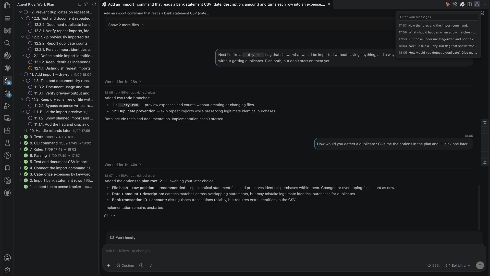
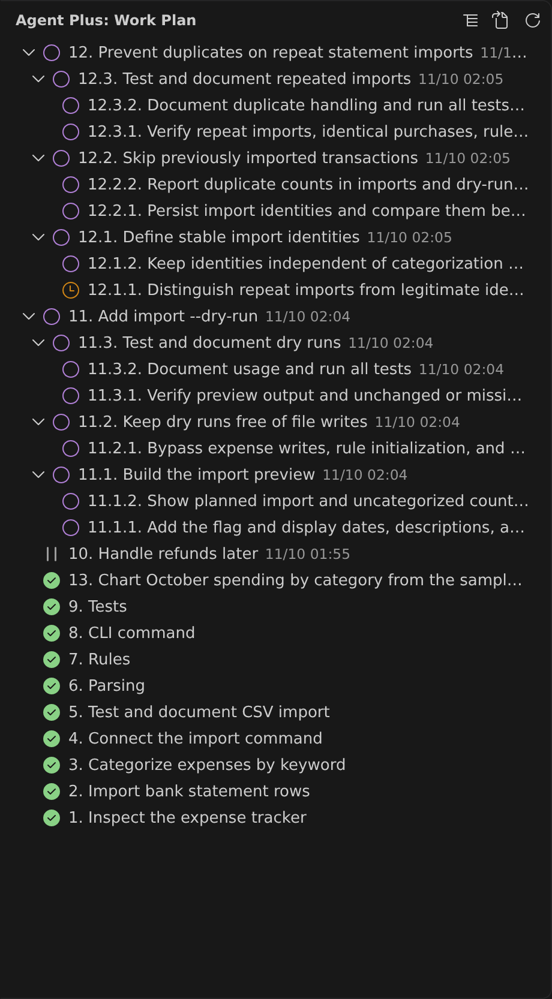
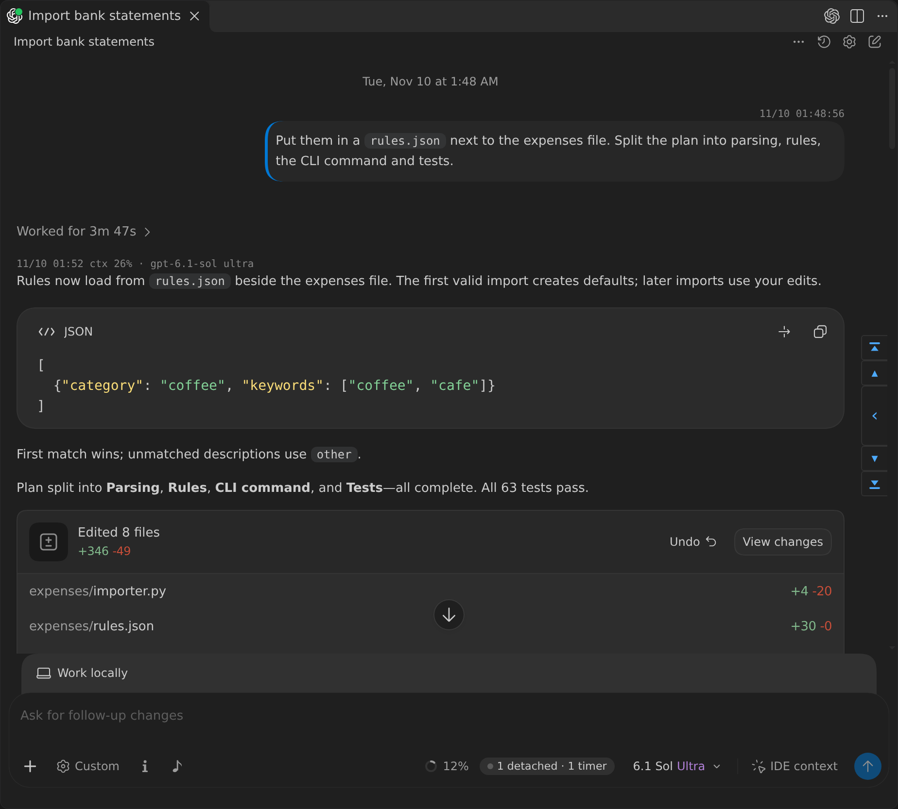
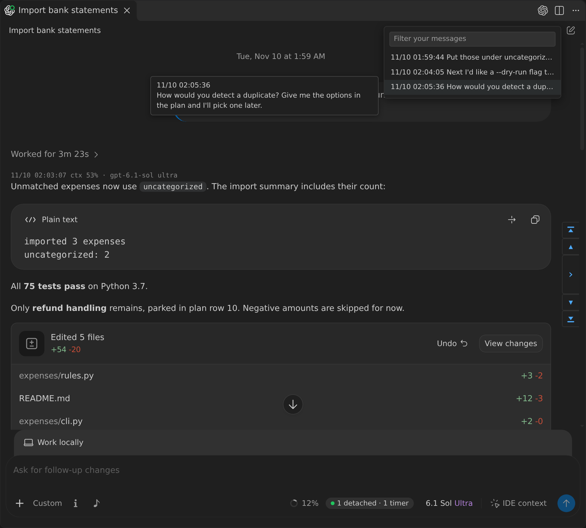
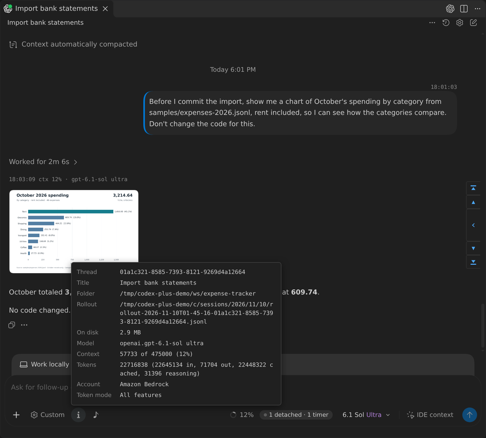

# Codex Plus

Codex Plus is a VS Code extension that adds a work plan for each conversation to Agent Plus's views, a sidebar list of conversations laid out like Claude Code's list, and times, a rail of your own messages, a context meter, chimes and tab dots to the conversation page, message box and tabs in Codex, OpenAI's VS Code extension (`openai.chatgpt`).

## Getting started

1. Install Codex Plus. VS Code installs Agent Plus along with it. To install from `.vsix` files instead, see [Install](docs/install.md#install).
2. When Codex Plus starts, it installs the work plan plugin into Codex and edits Codex's installed files without asking. This README calls the file edit "the patch". When Codex asks whether to trust the plugin's hooks (scripts Codex runs at set points, such as when you send a message or when Codex has finished working on it), trust them. You can also do this later in Codex: Settings > Hooks. When Codex Plus offers to reload the window, reload it.
3. After the reload, you see a Codex Plus sidebar listing your Codex sessions. In a Codex conversation, you see the time above every message, a rail of your own messages at the right edge, and an information button, a note button and a context meter in the message box's toolbar. A coloured dot appears on a Codex tab's logo while its conversation is working, has a reply you have not read, or waits for your permission. Your Codex conversations also appear in Agent Plus's Work plan and Conversations views.
4. To turn things off, `Codex Plus: Turn Off` stops drawing what Codex Plus adds to Codex's page and tabs. Agent Plus's token mode (`agentPlus.tokenMode`) decides which features may add text to what Codex sends the model. Set it to Interface features to stop Codex Plus adding anything to what Codex sends the model. `Codex Plus: Remove the Patch from Codex` puts Codex's own files back. All three are in [Turning it all off](docs/install.md#turning-it-all-off).

`Codex Plus: Show Status` shows what is installed, what is patched and what is registered with Agent Plus.

## Features

Most of what Codex Plus draws in Codex's page, message box and tabs needs the patch.

### Work plan

Agent Plus's Work plan view shows a conversation's [work plan](docs/work-plan.md) as numbered rows with states such as `todo`, `doing`, `waiting` and `done`. Codex receives the plan with every message and updates it with the work plan plugin's tools; the plugin reminds Codex to update it at the end of a turn and around compaction.

### The brief and plan questions

Click a conversation in Agent Plus's Conversations view to see its [brief](docs/work-plan.md#the-brief) in the Answer view: a summary and status written by Codex. Use the Answer view to [answer a question](docs/work-plan.md#answering-a-plan-question) Codex has put on a plan row; when the conversation's message box is empty, your answer goes into the box and is sent as if you had pressed Enter.

### Wake-ups

When you ask for a [wake-up](docs/work-plan.md#wake-ups) or before a long stretch of work, the model can set one with the work plan plugin's `set_wakeup` tool, and Codex Plus then sends its prompt to the idle conversation at the interval the model chose (every 5 minutes by default), so unfinished work can continue without you. A conversation can have one wake-up and receives its prompts only while open in this VS Code window; the wake-up is removed seven days after it was set, or you can remove it sooner with the Remove button in the Agent map.

### Your time zone

When Codex runs on another machine, the work plan plugin tells Codex [your time zone](docs/work-plan.md#your-time-zone), the other machine's time zone and the current time, unless Codex's own page has already supplied the same zone since the last compaction. You can turn this off with `codexPlus.tellCodexYourTimeZone`.

### The session list

The [Codex sessions view](docs/session-list.md) in the Codex Plus sidebar lists your conversations using the layout of Claude Code's list in Claude Code Plus and your theme's colours. Each row shows status, unread replies and time since last use; you can filter by status or search by title, branch or four hex characters of the conversation ID.

### Menus, groups, archive and goals

Use a row's [right-click menu](docs/session-list.md#menus-and-groups) to rename or colour a conversation, move it into or out of a group, mark it as read or unread, [archive it](docs/session-list.md#archive-and-delete), or pause, resume or clear a [goal](docs/session-list.md#goals) that Codex works toward on its own. In Archived sessions, Delete asks before deleting a conversation's log; once a day, Codex Plus deletes conversations archived at least `codexPlus.deleteArchivedAfterDays` days ago (30 by default) without asking.

### Tabs

With the patch, [Codex Plus's tab bar button](docs/tabs.md) replaces Codex's and opens a new conversation in a tab, or opens Codex's sidebar if `codexPlus.tabBarButton` is set to `sidebar`. Each Codex tab shows the conversation's status dot on its logo, as its row in the session list does, uses the conversation name as its title and adds an envelope to the title for an unread reply; Codex Plus reopens tabs that VS Code missed after a reconnect, and Ctrl+Shift+T (Cmd+Shift+T on a Mac) reopens the conversation from the last Codex tab you closed.

### Times and turn figures

[Times above messages and replies](docs/conversation.md#times-above-messages-and-replies) use your time zone; each reply also shows the turn's share of the context window, model and effort, plus its duration if Codex shows no "Worked for" time. The [row below the message box](docs/conversation.md#the-row-below-the-message-box) shows the current tool call while Codex's row for it is out of view and counts the commands Codex started that are still running.

### The rail of your messages

The [rail at the right edge of the conversation](docs/conversation.md#the-rail-of-your-messages) lists your messages by time and opening words and marks where Codex compacted the context; you can filter the list, click a row to scroll to it or step through it with the arrow keys or `,` and `.`. [Your messages](docs/conversation.md#your-messages-and-hook-prompts) have a bar in the theme's focus colour along their leading edge, and Codex Plus folds a Stop hook's prompt to continue a turn into one dim line.

### Links to your other conversations

When a reply names another conversation by its whole title, a title between `「` and `」`, or its ID, Codex Plus turns the name into a [link to that conversation](docs/conversation.md#links-to-your-other-conversations). Hover to see the title, agent, first 8 characters of the ID and how long ago the conversation was active, or click to open it through Agent Plus, which lists conversations from every agent it knows, including Claude Code.

### Images in replies

Codex's VS Code panel shows [images in replies](docs/conversation.md#images-in-replies) from absolute local paths, `file://` URLs and `data:` URLs; with `codexPlus.replyImages` on (the default), the work plan plugin tells the model the panel can show images and asks it to save a PNG or SVG in the conversation's folder and link to the absolute path. The patch replaces Codex's thumbnails (up to 10rem high) with images at their own size, scaled down as needed to fit within 640 by 480 pixels and 70% of the panel's height; it shows web images as plain links without fetching them.

### The information button

The [information button](docs/message-box-toolbar.md#the-information-button) in Codex's message box toolbar shows the conversation's thread ID, this window's Codex app-server process ID, the folder, the conversation log and its size, context window use, tokens used, the account and the token mode. Click a value to copy it.

### The context meter

The [context meter](docs/message-box-toolbar.md#the-context-meter) to the left of the model picker shows a ring and the share of the context window in use; Codex's own meter stays hidden while this one is visible. Hover to see which context window the meter uses, how many tokens are in use and free, the compaction threshold and how far away it is, the conversation's token counts and how much the work plan has added since the last compaction; click to compact as `/compact` does, without changing your draft.

### The Agent map

The [Agent map](docs/message-box-toolbar.md#the-agent-map) is a pill like Claude Code's that appears when a conversation has sub-agents, a wake-up or a goal, or while work it started is still running. Click the pill to see the conversation, its sub-agents, work it left running, its wake-up and its goal in a dialog where you can open a sub-agent in a tab, remove the wake-up or pause, resume or clear the goal.

### Chimes and waiting for your permission

Codex Plus plays Claude Code Plus's three [chimes](docs/waiting-and-chimes.md#chimes) when a turn finishes, when the model asks a question and waits for your answer, and when Codex [waits for your permission](docs/waiting-and-chimes.md#waiting-for-your-permission); the note button beside the information button in the message box's toolbar turns them on or off. When Codex waits for permission, the conversation shows as waiting in Agent Plus's Conversations view, its tab has a red dot, and Agent Plus shows a VS Code notification that Codex itself does not.

### Token mode

Agent Plus's [token mode](docs/token-costs.md) (`agentPlus.tokenMode`) controls which features may add text to what Codex sends the model: the work plan, the time zone note, the conversation brief, wake-ups and notices when a detached command or a `claude --bg` session ends. The modes are Interface features, Essential features, All features (the default) and Custom; what Codex Plus draws in VS Code sends nothing to the model, and the work plan adds about 90 tokens when it has not changed since the previous message (about half of all messages) or a median of about 520 tokens when it has changed.

### Codex's own list of skills

On each turn, Codex puts a [list of installed skills](docs/token-costs.md#codexs-own-list-of-skills) in the model's context, with a budget of 2% of the context window unless `skills.max_context_tokens` in Codex's `config.toml` sets a different budget, up to 10k tokens. Codex Plus writes `codexPlus.skillsListBudget` to `skills.max_context_tokens` when nonzero and leaves it alone at the default of 0; Codex leaves skills named in `codexPlus.disabledSkills` out of the list and does not run them.

### Show Status

[`Codex Plus: Show Status`](docs/status-and-load.md#show-status) writes to the Codex Plus output channel what is installed, what is patched and what is registered with Agent Plus. It also shows the token mode, whether this Codex Plus release was checked against the installed Codex build, whether Python was found, which wake-ups are set, which commands Codex started are still running and how long the last three Codex pages took to open.

### CPU and disk

Codex Plus [checks Codex's files for changes](docs/status-and-load.md#cpu-and-disk) every 3 seconds; when no files had changed, the median check took 0.23 ms across 12 runs on one machine. On Linux, VS Code windows on the same machine share a scan of `/proc` about every 12 seconds to find processes a conversation started that are still running after its turn; a scan took 38.5 ms, and turning `codexPlus.enabled` off stops the scan.

## For developers

How Codex Plus is checked against each new Codex build, and the render check that draws Codex's real page with this extension's script in it, are in [CONTRIBUTING.md](CONTRIBUTING.md).
