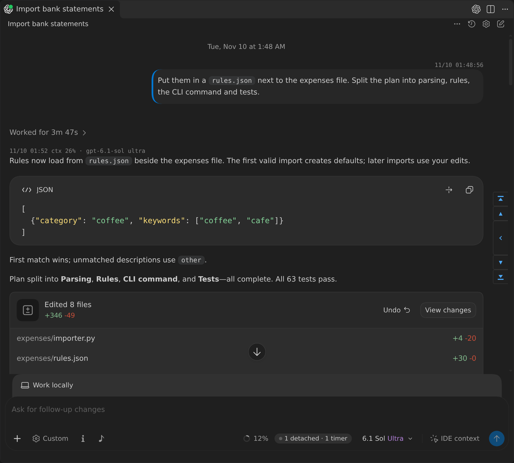
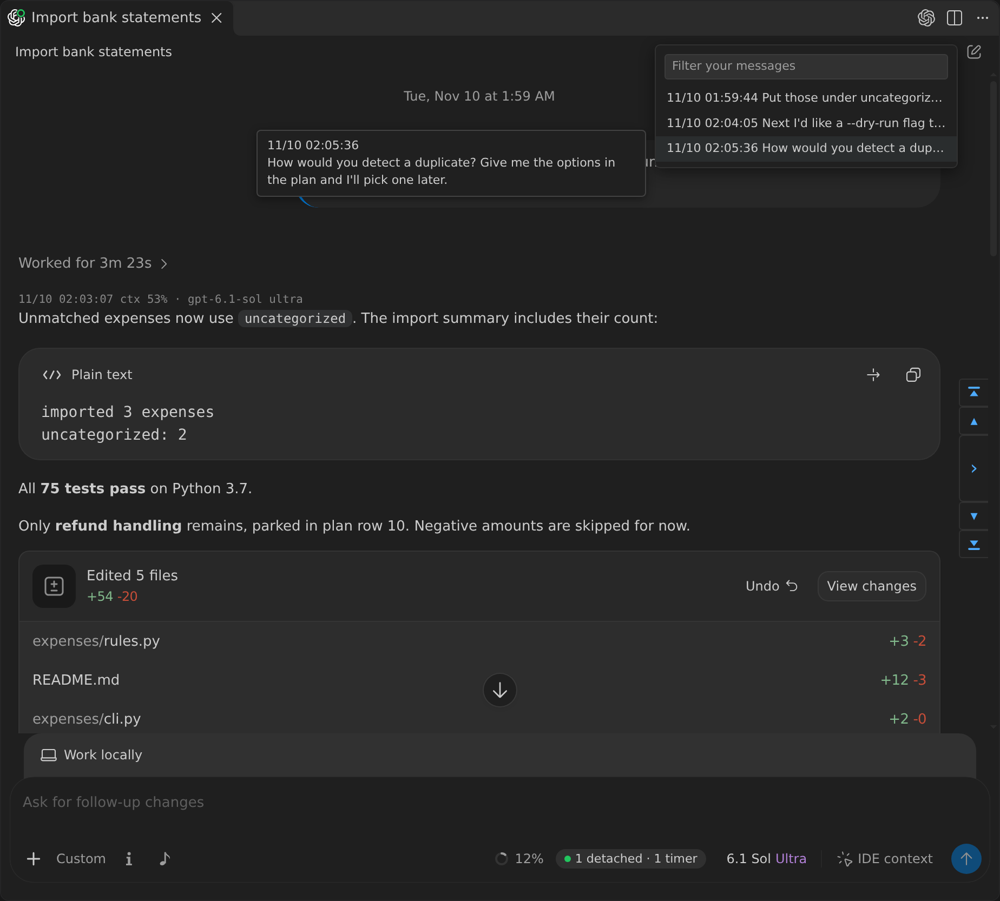
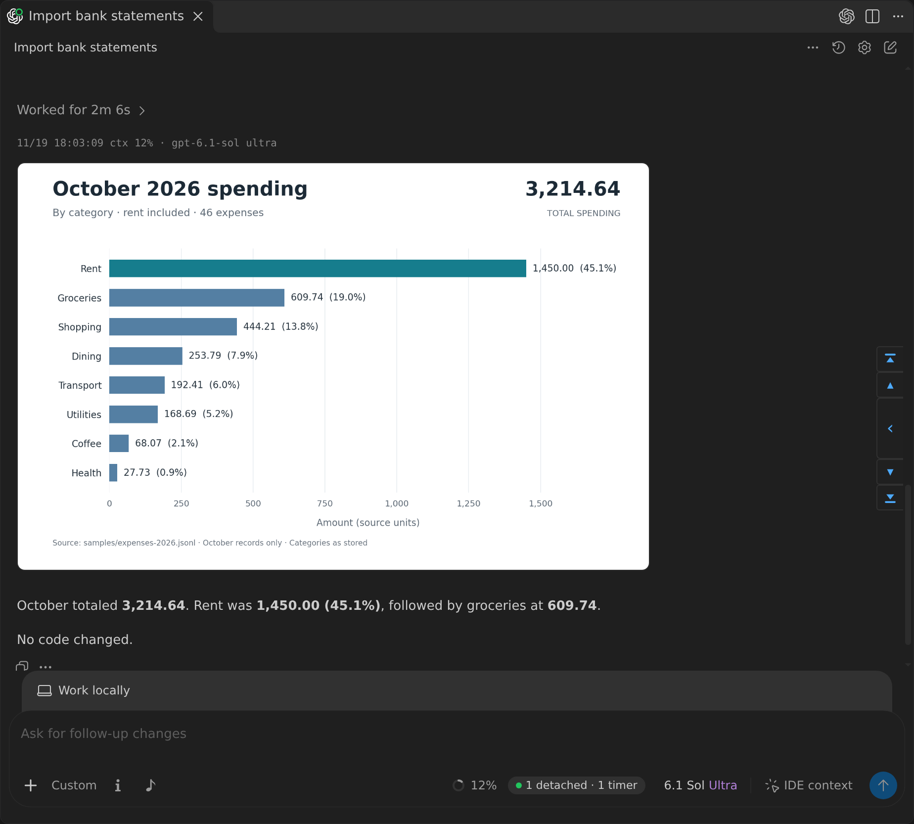

# In a conversation

Codex Plus shows a time above each message and reply, puts figures beside each reply and displays images in replies at their own size. It also adds a rail of your messages, marks on your messages, links to your other conversations, a plan bar above the message box and a row below it.

Codex Plus draws these additions into Codex's own page. Each needs the patch and a window reload, because the page keeps running the script it was built with.

How the page script (the script Codex Plus adds to Codex's page) reads the times and what it changes there is in [docs/codex-page.md](codex-page.md#inside-a-codex-conversation).

## Times above messages and replies

The time appears above every message and reply block in your own time zone, including a message you send while a turn runs. It replaces Codex's time below a reply and beside your message. A time read from the conversation log includes seconds (`HH:MM:SS`); one read from the clock Codex shows on its page has only `HH:MM`. Messages from another day start with `MM/DD HH:MM:SS`, or include the year (`YYYY/MM/DD`) if it is not this year. `codexPlus.timestamps` turns the times off.

Beside each reply's time, you see that turn's share of the context window (see [The context meter](message-box-toolbar.md#the-context-meter)), model and effort, for example `14:02:11  ctx 33% · gpt-6.1-sol high`. Codex Plus matches them by the turn ID Codex puts on the reply; `codexPlus.turnFigures` turns them off. When Codex shows no "Worked for" of its own, the time also includes the turn's duration, for example `14:02:11  9s · ctx 33% · …`. Codex draws "Worked for" only when a turn did something before its reply. `codexPlus.replyDuration` turns the added duration off.

## The rail of your messages

The rail at the right edge lists your messages by time and opening words, along with where Codex compacted the context. Click a row to scroll to it, step with the arrow keys or `,` and `.`, filter, or jump to the top or bottom. As in Claude Code Plus, the list is 280 px wide and shows 44 characters per row. The opening words are read and shown in the page, not sent anywhere. `codexPlus.conversationNavigation` turns the rail off.

Resting on a rail row shows its time and first 220 characters together in a box beside the list. Every rail button has its own explanatory box. After a jump, the view stays on the message for about a second while Codex's turns still move. A wheel, touch or key releases it.

## Your messages and hook prompts

Your messages have a bar down their leading edge in the theme's focus colour. `codexPlus.userMessageEdge` turns the bar off. `codexPlus.userMessageColor` sets their text colour to a CSS colour such as `#90EE90`, `lightgreen` or `rgb(144,238,144)`. An empty value, the default, keeps Codex's colour.

A Stop hook can prompt Codex to continue a turn. Its bubble appears on your side with "Hook feedback" underneath. Codex Plus folds it to one dim line. It drops the bubble background and skips your message bar and text colour. Folding has no separate setting. Click the line to show the whole prompt, then click it again to fold it.

## Links to your other conversations

When a reply names another of your conversations, Codex Plus shows the name as a link in the theme's link colour. Agent Plus supplies conversations from every agent it knows, including Claude Code. Codex Plus leaves the reply unchanged while Codex writes it and adds links about half a second after the reply is complete, once Codex has drawn it again.

A whole title between 「 and 」 matches if it has at least 4 characters or at least 2 Chinese, Japanese or Korean characters. Without brackets, the whole title must be at least 10 characters wide (a Chinese, Japanese or Korean character counts as two), with no letter or digit immediately before or after it. These minimums keep short titles from matching ordinary words. A full conversation ID also matches, as do its first 8 characters if no other conversation's ID starts with them.

Codex Plus skips the conversation the reply belongs to, placeholder titles such as "untitled" and "New chat", code blocks and text that is already a link. Only conversation IDs can become links in inline code, and an ID stays unlinked wherever it appears next to a slash or is followed by a file extension.

Hover over a link to see the conversation's title, its agent, the first 8 characters of its ID and how long ago it was active. If several conversations have the same title, the link opens the one that was active most recently, and the hover lists the others.

Clicking a link opens the conversation through Agent Plus. A VS Code window already showing the conversation brings it to the front; otherwise, Agent Plus follows its usual rule for that agent, which for Codex offers "Open it here".

`codexPlus.conversationLinks` is on by default. The links add nothing to what Codex sends the model.

## The row below the message box

Codex Plus adds a row below the message box. At its right end, it shows the tool call running now, such as `exec_command running for 2m55s (since 11:11:18)`, while Codex's row for that call is out of view. When Codex's row is in view, it already says this. The same place counts commands Codex started that are still running, such as a build or a `sleep` left in the background, until Codex reports that the process ended.

`Codex Plus: Show Status` lists each still-running command, when it started and which conversation it belongs to. Codex Plus sees only this window's Codex. If you reload the window while a command runs, it learns of that command only when it ends. `codexPlus.turnFigures` turns off the tool-call display and command count too.

## The plan bar

The plan bar shows the conversation's [work plan](work-plan.md), a list of numbered rows that Codex keeps through the work plan plugin. The bar updates as the plan changes. It sits on one line just above the message box and matches its width. It takes 32 px of height from the conversation without covering it or Codex's question or approval cards. Conversations without a work plan have no bar.

From left to right, the bar shows a list icon, "Plan", a short track with one segment per open row coloured by state, "N open", and the current row with its number and state icon. If any rows need your answer, "N to decide" appears in red. An arrow sits at the right end. The open count excludes done and dropped rows. Below 400 px wide, for example in Codex's sidebar, the bar shows only "Plan", the open count, the question count and the arrow.

The bar shows the deepest doing row. If none is doing, it looks for a waiting row, then a discussing row, then a todo row, and shows the first row in the first state it finds. If only parked rows remain open, the first parked row appears dimmed. When all rows are done, the bar shows a green tick and "All rows done".

Rest the pointer on the bar for 350 ms to see the current row's full title and a list of up to 30 open rows. Click the bar to open this conversation's plan in the Work plan view of Agent Plus, the companion extension. Click "N to decide" to open its Answer view at the first question. The bar requires the Codex Plus patch to Codex's page and a window reload. It appears only if Agent Plus provides the plan summary. The bar is on by default. Turn off `codexPlus.planBar` to hide it, or `codexPlus.enabled` to turn off Codex Plus.

## Images in replies

Codex's VS Code panel shows images linked by absolute local paths, `file://` URLs or `data:` URLs. Relative paths do not display images. When `codexPlus.replyImages` is on (the default), the plugin sends the model a note of about 450 characters explaining that the panel shows images. It asks the model to save a PNG or SVG with an ASCII name in the conversation's folder and link to its absolute path. For a web image, it asks the model to download the file into that folder first. The folder is `$CODEX_HOME/scratch/<working directory>/<conversation ID>/`, with each character other than a letter or digit in the working directory replaced by `-`. The plugin sends the note when a panel conversation starts and after each compaction. It skips `codex exec`, terminal conversations and Codex builds that Codex Plus has not been checked against.

In Codex, reply images are thumbnails up to 10rem high. The patch displays each image at its own size, scaling it down as needed to fit within 640 by 480 pixels and 70% of the panel's height.

Whether the setting is on or off, the patch shows a web image as a plain link. The link text is the image's alt text, or its address if there is no alt text. Codex Plus does not fetch it. With a ChatGPT login, Codex checks the address with OpenAI's service and can load the image before the patch turns it into a link. Turn `codexPlus.replyImages` off and the patch shows other images as `[Image]`, with the path on hover. If it sent the note earlier in the conversation, it tells the model in the next message that the panel no longer shows images. The setting has no effect when `codexPlus.enabled` is off.
