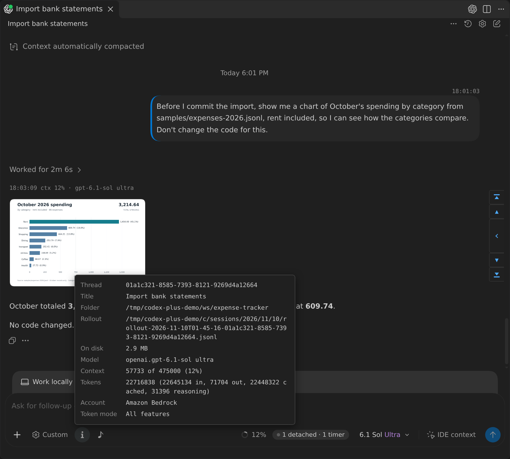
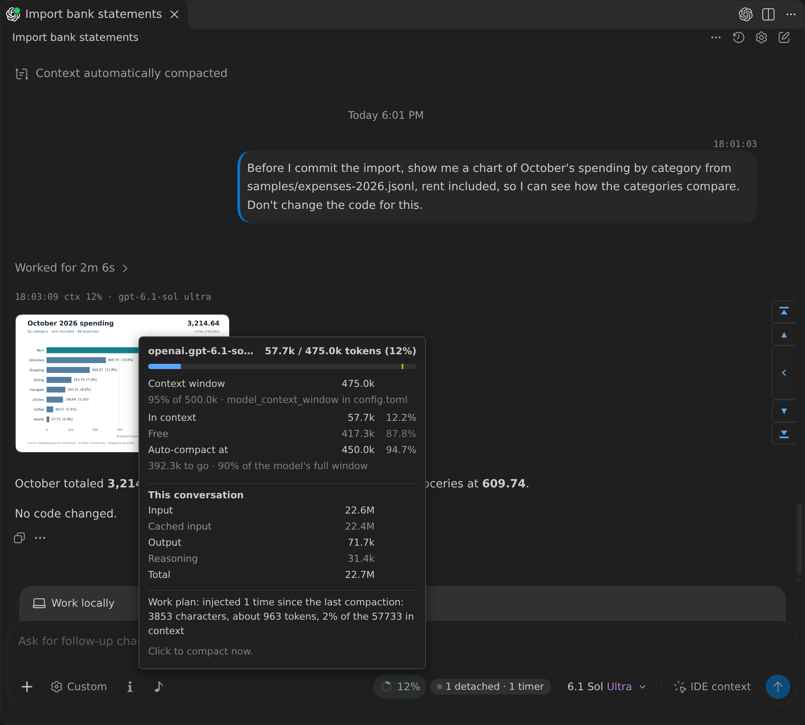
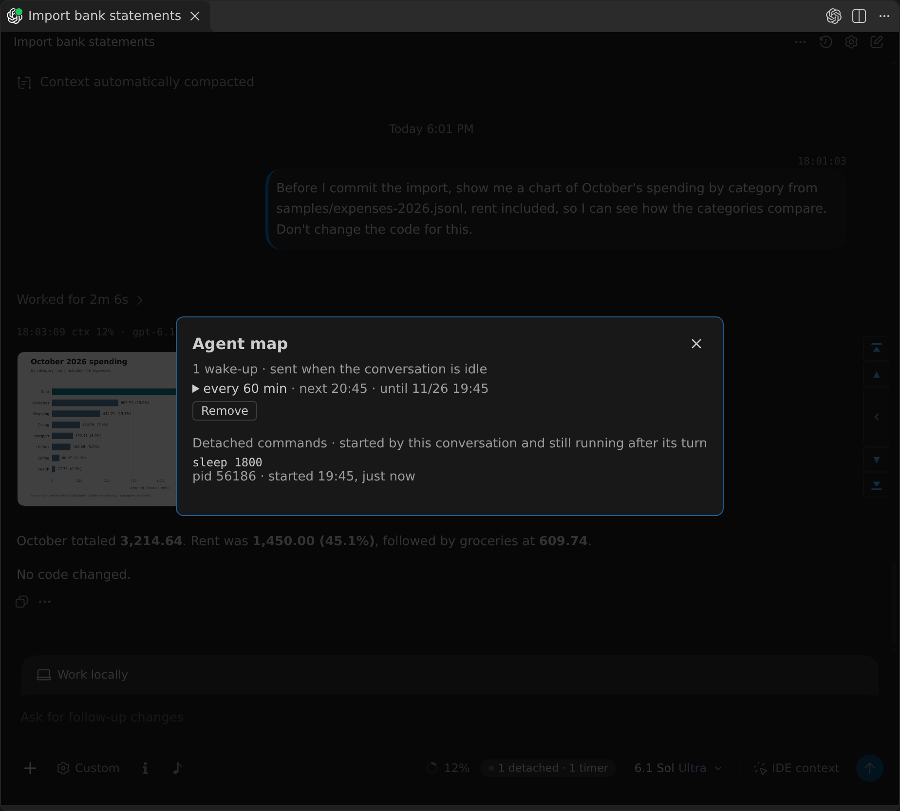

# The message box's toolbar

Codex Plus puts four controls in Codex's toolbar row in the message box. The information and note buttons follow Codex's permissions button. The context meter sits left of the model picker, where Codex puts its own meter. The Agent map sits right of the context meter. The note button is described under [Chimes](waiting-and-chimes.md#chimes).

The controls look like Codex's buttons because they take CSS classes read from the page: the two icons use the add-context button's classes, and the meter uses the permissions pill's. Pressing a control leaves the caret in the message box, and its click reaches nothing else on the page. The controls enter the toolbar only after the model picker shows the model's name. If the row is full when Codex lays out that name, Codex draws the picker as a bare icon and keeps it that way.

The controls move to a line of their own inside the message box, below Codex's buttons, when they do not fit in the toolbar, would move the model picker, or would hide more of the model's name. The information and note buttons sit at the left of that line, and the context meter and the Agent map sit at the right. The two buttons and the meter are the same size as Codex's buttons. Claude Code's message box footer wraps its buttons the same way. The extra line makes Codex's message box about one button row taller. The controls go to the row Codex Plus adds below the message box only if the message box cannot hold their line (see [In a conversation](conversation.md#the-row-below-the-message-box)). They try the toolbar again only when it has room for them plus 24 pixels. This keeps them from moving back and forth when you resize near the edge. Once back in the toolbar, they leave it if room runs out, the picker loses its name, or more of the name becomes hidden than when they entered. They stay in the toolbar when the model picker would cut a long model name just as much if the controls were not there. None moves while your pointer is on a control or a box it opened.

## The information button

The information button shows the conversation's thread ID, this window's Codex app-server process ID, folder, conversation log and its size, context window use, tokens used, account and token mode. Click a value to copy it. `codexPlus.infoButton` hides the button. It needs the patch.

## The context meter

The meter shows a ring and the share of the context window in use. Codex's meter is hidden while this one is drawn, leaving one reading in the row; it returns when `codexPlus.contextMeter` is off. Hover to see which context window it uses and where that figure came from (`codexPlus.contextWindow`, below, can set it), tokens in use and free, where Codex compacts and how far away that is, conversation input, cached input, output and reasoning tokens, and the model and effort. You also see how many times the work plan has added context since the last compaction, how many characters those additions came to, and about what share of the context in use that is. The meter needs the patch.

Codex's meter and this one can differ: Codex divides the last model call's input and output by the context window; this meter divides input alone, as the figures beside replies and the work plan plugin's compaction reminders do. This meter reads figures from the conversation log every 3 seconds, while Codex's follows the app-server live. `codexPlus.contextWindow` gives each listed model its own window, up to `1.05M` for GPT-6 models, using OpenAI's published window including output. Codex caps GPT-6.1 Sol's input at 872K. An already loaded conversation keeps its old window until you reload the VS Code window; without the patch, the setting applies only to the default `model` in `config.toml`.

Clicking the meter starts a compaction now by sending `thread/compact/start` to this window's app-server. Codex's `/compact` sends the same request. The compaction appears in the conversation and counts as one of Codex's own model calls. Codex offers `/compact` only when the message box is empty; the meter does not touch the box, so your draft stays. While a turn runs or an approval waits, the click is refused, as Codex refuses `/compact` then: "Compact is disabled while a chat is in progress".

Codex compacts at 90% of the model's full window, or at `model_auto_compact_token_limit` in `config.toml` if lower. The meter counts against the window Codex reports, which is 95% of the full one, so Codex compacts when the meter reads about 94.7%. Once the meter reads 80% or more, 15 points before that, an outline appears, as Claude Code Plus outlines its meter 15% before compaction. When this extension's meter is not drawn, the outline goes on Codex's meter, which Codex draws only when you turn on General, Composer, Show context window usage in Codex's settings. `codexPlus.lowContextOutline` turns the outline off.

## The Agent map

The Agent map requires the patch. It appears as a pill like Claude Code's, for example `2 agents · 1 detached · 1 terminal · 1 timer · goal`. A conversation with a wake-up (the timer), a goal or sub-agents shows the pill. The pill also appears while any work the conversation started is still running: detached commands, background terminals, `codex exec` runs, `claude -p` workers or `claude --bg` sessions. The pill's dot is green while work runs and turns grey once all the work has ended. A red dot means a sub-agent is waiting for you.

Click the pill to open the dialog, or press Esc or click outside it to close it. At the top, "This conversation" has a card with the conversation title, the dot shown on its tab, the model and the number of tokens in its context. Below it, SUB-AGENTS, WORK LEFT RUNNING, WAKE-UPS and GOAL appear in that order, each with a count; empty sections are omitted.

Hover over any row to see the full command line or title; each row is a card with a dot, a one-line title and a line of details below it. A sub-agent card shows its name, an envelope for an unread reply and when it was last active; its dot uses the same four states as the session list, and clicking the card opens the sub-agent in a tab. Under WORK LEFT RUNNING, detached commands, background terminals and `codex exec` runs use the command line as the title, with just the last part of the program's path; `claude -p` workers and `claude --bg` sessions use the names Claude Code gives them. The second line shows the kind of work, its PID or `claude --bg` job ID and when it started, and a green dot marks running work.

A wake-up card shows the first line of its prompt above its interval, next wake-up and end, while the goal card shows the first line of the goal above its state and the tokens it has used. Click either card to read the full prompt or goal, or use the buttons below the card: Remove for a wake-up, and Pause, Resume or Clear for the goal.

