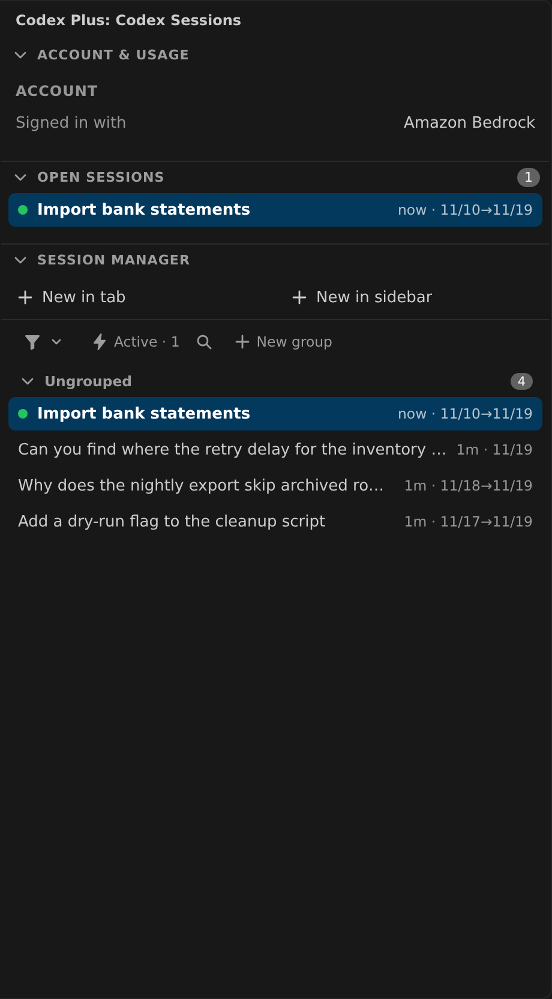

# The session list

The Codex sessions view in the Codex Plus sidebar lists your Codex conversations. It follows the layout of Claude Code's list in Claude Code Plus, this extension's counterpart for Claude Code, and uses your theme's colours. `codexPlus.sessionList` hides the view.

## Sections

From top to bottom, the list shows Account & usage, Recently closed and Open sessions, each with its count. Your groups, Ungrouped and Archived sessions follow. A group you made stays visible when empty. Recently closed, Open sessions, Ungrouped and Archived sessions are omitted when empty.

Recently closed contains the conversation a tab showed when it closed, including a tab opened with a New button. It lists up to `codexPlus.recentClosedSessions` conversations. The default is 10; 0 hides the section. Open sessions includes tabs Codex opened with its own New button, whose URI names no conversation. This needs the patch.

Open sessions also lists the conversation in Codex's sidebar while the sidebar is visible. Clicking that row goes to the sidebar. It is the conversation the sidebar last went to, so while the sidebar shows its own new-conversation page, the conversation it showed before is still listed. This needs the patch. The session list marks the conversation in the active editor tab or Codex's sidebar as current, whichever came to the front last. Agent Plus's Work plan view follows the same conversation. If you hide Codex's sidebar while it is in front, both views return to the conversation in the active Codex tab. As in Claude Code's list, that conversation is scrolled to in Open sessions without moving your focus.

## Rows

Rows are 28 px high, with an 8 px status dot, a title, an envelope for a reply you have not read, and the time on the right. Rename replaces the time on hover. Group names have count badges, section labels are in capitals, and New in tab and New in sidebar sit side by side.

A row shows how long ago you last used a conversation and the first and last day you used it, as `2d · 11/05→11/09`. The time uses `now`, `5m`, `3h`, `2d`, `1mo` or `1y`; dates in another year include the year, as in Claude Code's list. You can give a title a colour with Text Color (see "Menus and groups"). Hovering shows its group and session ID, as Claude Code Plus writes them.

`codexPlus.hideBackgroundSessions` is on by default. The session list hides conversations started by `codex exec`, sub-agents and approval reviews (conversations Codex starts to check whether to allow a requested action). Turning the setting off lists them with the rest. Each sub-agent's row shows its nickname, as in the Agent map, and has its own status dot. The row is indented under the conversation that started the sub-agent and shows that conversation's name on hover. The sub-agent's row stays unindented if its parent is missing from the list.

## Status dots

Each row in the session list shows the conversation's status in Claude Code Plus's colours. A green dot means a turn is running. A green ring means the turn has ended and only work the conversation started is still running. A red dot means the conversation is waiting for your approval or answer. A stopped conversation has no dot. An envelope (✉️) between the title and the time marks a reply you have not read, regardless of the dot. The envelope sits outside the title, so it stays visible when a long title is cut short. In a light theme you see the text form (✉︎) because a colour emoji font draws ✉️ in white.

A conversation keeps the green ring while something it started is still running after its turn. Hovering names the sub-agent, Codex background command, shell detached with `setsid` or `nohup`, `codex exec` or `claude -p` worker (a one-off Codex or Claude Code run started from a command line), or `claude --bg` session (a Claude Code session started in the background). Detached shells and those workers are found through `/proc`, so detection works only on Linux.

If a conversation leaves a command running detached, Codex Plus notifies that conversation when the command stops. Commands that stop within a minute of each other share one notice. Codex Plus cannot tell what exit code a detached command returned. If a conversation starts a `claude --bg` session, the conversation gets a notice with the session's result, error or question when the session finishes, fails, dies, waits for an answer or is stopped. Codex Plus skips the notice if the conversation stopped the session itself. An idle conversation starts a turn with either notice. Both notices need All features token mode, or Custom with `codexPlus.detachedEndNotices` on ([What it costs in tokens](token-costs.md)).

A reply is unread if its turn ended after you last had the conversation in front of you in a focused window, either in its tab or in Codex's visible sidebar. That holds while work it started is still running, and while a later turn runs. Bringing it to the front clears the unread state in every window. Codex Plus does not use Codex's unread marks because nothing inside VS Code marks them read.

## Searching and moving rows

The filter row offers a status filter (Needs input, Working, Completed, and Open or Closed tabs, each with a count), an Active filter (needing input, working or unread), search by title, branch or four hex characters of the ID, and New group. Typing in the list starts a search. Arrow keys move through rows, Enter opens one, and Esc clears the search or selection.

Drag rows onto a group's header to move them into that group. Drag them onto Ungrouped to remove them from every group.

## Starting and resuming conversations

New in tab and New in sidebar start a Codex conversation. Resume in tab and Resume in sidebar appear only when the conversation is not open in this window, as in Claude Code Plus. With the patch connected, Resume in Sidebar and New in Sidebar navigate Codex's sidebar directly in this window. Without the patch, they open Codex's own link, `vscode://openai.chatgpt/local/<id>` in this editor's scheme. VS Code sends the link to the window it last saw focused, which can be another window. [Tabs](tabs.md) covers where New in tab opens its tab.

## Account & usage

Account & usage sits at the top, as it does in Claude Code's list. It shows how Codex is signed in: Amazon Bedrock, an API key, or a ChatGPT account's email and plan. Only when Codex provides the figures does it show each rate limit's share used and reset time, and tokens spent today and in total.

When the list comes into view, Codex Plus asks this window's app-server for the information, at most once a minute. It then uses notifications Codex sends anyway to keep it current. This section needs the patch and is hidden without it.

## Menus and groups

Codex Plus draws the row's right-click menu in the look of Claude Code's own. It has Rename (also available on hover), Text Color and Add to Group (submenus opening to the right, as in Claude Code Plus), Remove from Group, Mark as Unread or Mark as Read, and Archive. Every one of them but Rename acts on all the selected rows.

A group's header offers Start New Session in This Group, New Group, Rename Group and Delete Group. A conversation started in a group moves into it after its first message is sent, when Codex lists it. Groups are Codex's own sections, but Codex Plus keeps their order because Codex keeps none. Codex's built-in Pinned section is never offered as a group to add to.

Every action here except Mark as Unread and Mark as Read goes to this window's app-server over Codex's own connection. Before the patch takes effect, it goes to a short-lived app-server Codex Plus starts instead. Mark as Unread and Mark as Read change only Codex Plus's record of what you have read.

## Archive and delete

Archived sessions is the last group and stays collapsed until you open it. It lists this workspace's conversations archived from the list or Codex itself, most recently archived first. Archive works whether the conversation is open or not, as in Claude Code's list. Starting with Codex 26.1117, archiving a conversation open in a Codex tab or sidebar takes you to the home page. With Codex Plus, the transcript stays on screen in the same read-only view you get when you open a conversation from Codex's Archive page. Open the conversation from its row in Archived sessions to unarchive it and write again. Codex moves its log to `archived_sessions/` and archives its sub-agents with it. A conversation that is running, or has a running sub-agent, is not archived because Codex would stop its turn.

An archived row's menu has Resume in Tab, Resume in Sidebar, Text Color and Unarchive. Opening an archived conversation, from its row or its menu, unarchives it first, since Codex shows no archived conversation. After a separator it has Delete, which no other row has. Delete asks first and says that Codex will delete the conversation log and its sub-agents' logs. You can't delete a conversation while it's running or open in any VS Code window; if another window has it open, the message names that window. If you try to archive a conversation that another window's app-server has loaded, Codex refuses with "already has an active writer"; archive it from the window that has it open.

Once a day, one of your windows deletes conversations archived at least `codexPlus.deleteArchivedAfterDays` days ago in the same way, without asking. The default is 30 days; 0 keeps them. The output channel "Codex Plus" lists what was deleted. Days count from Codex's archive time, or from when Codex Plus first saw an archived conversation if Codex recorded no time. Codex Plus checks any conversation skipped during daily deletion again the next day.

## Goals

A conversation's goal is something Codex works toward on its own. It starts another turn whenever the conversation is idle, until the goal is done, blocked or out of its token budget. To set one, ask Codex for a goal in the conversation. The row shows `goal`, `goal paused` or `goal: budget spent`; hovering shows the goal and tokens used from its budget.

Pause Goal, Resume Goal and Clear Goal are in the row's right-click menu and in the command palette for the conversation in front. Resume Goal lets the goal start turns again, using Codex's own model calls. Each change is sent as yours to this window's app-server on Codex's own connection. Before the patch takes effect, it goes to a short-lived app-server Codex Plus starts.

## Not in this list

Three things in Claude Code's list are not in this one:

- Usage for an Amazon Bedrock account, and money: for Amazon Bedrock, Codex returns an error to `account/rateLimits/read`, as its own `/status` reports "Rate limit: Unavailable", so Account & usage shows only how Codex is signed in. No price or balance is shown for any account.
- Local / Web switches between Claude Code's own sessions and cloud sessions. Codex's cloud tasks come from ChatGPT's servers, which this list does not read.
- Pinning keeps Claude Code's own clean-up from archiving a session idle for 14 days. Codex archives nothing on its own, and Codex Plus deletes only archived conversations. A conversation pinned in Codex's desktop app is in Codex's built-in Pinned section, which this list shows as a group while it holds something.
