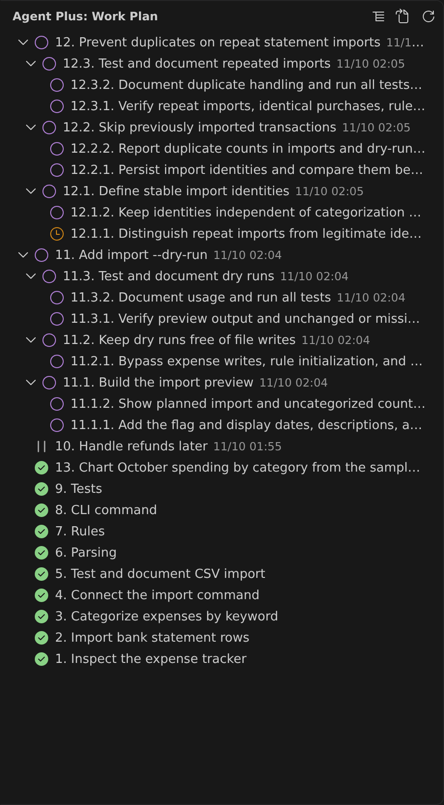

# The work plan, wake-ups and your time zone

## Work plan

Codex conversations appear in Agent Plus's Work plan, Conversations and Answer views. [Agent Plus's README](https://github.com/xnervwang/vscode-agent-plus) says what each view shows. Each conversation can have a work plan: numbered rows, each with a state. Open rows are `discussing`, `todo`, `doing`, `waiting` or `parked`; closed ones are `done` or `dropped`. Codex keeps the plan across turns (one message of yours and Codex's work on it) and compactions (when context fills up and Codex replaces the conversation so far with a summary).

Agent Plus's Work plan view shows the plan, which Codex receives with every message. Each conversation's plan is a file, `<conversation ID>.json` (the thread ID the [information button](message-box-toolbar.md#the-information-button) shows), in the work plan plugin's data folder, `plugins/data/agent-work-plan-codex-extras/` in Codex's home folder (`~/.codex` unless you set another).

The work plan needs the work plan plugin, which Codex Plus installs into Codex, and needs its hooks to be trusted. Codex changes rows with the plugin's `set_row` and `add_row` tools, and changes the brief with `set_summary` and `set_status`. These tools come from the plugin's MCP server, a process the plugin runs that offers Codex tools through the Model Context Protocol. Calling them needs no sandbox approval. If Codex edits the plan file directly, the edit is refused.

At the end of a turn, the plugin reminds Codex if any rows are still `doing` (in progress), if Codex hasn't updated the plan to reflect the turn, or if its last reply seems to ask you a question but Codex didn't record the question in a row during the turn and no row already shows that your answer is needed. Each reminder ends by asking Codex to answer you in the language it has been using with you. Before automatic compaction, it reminds Codex to update `doing` rows when the context reaches 70% and 85% of the point where Codex compacts. Codex compacts at 90% of the model's context window, or at `model_auto_compact_token_limit` in Codex's `config.toml` when that is lower. After compaction, the plugin points Codex to the plan. `codexPlus.workPlanQuietWhenReplyMatches`, a regular expression, keeps these reminders quiet when the latest reply matches it, for conversations that relay another model's replies word for word.

If a conversation has no plan, Codex is offered one once, after your third message, in a turn of at least 25 tool calls. `codexPlus.workPlanOfferMinTurns` and `codexPlus.workPlanOfferMinToolCalls` set those two numbers. `codexPlus.workPlan` turns the work plan off.

### The brief

The brief is the conversation's summary and status. The work plan text sent with each message ends with a sentence asking Codex to write the status before its final reply. If a turn did work without writing the status, Codex is asked for it once at the end of that turn.

Codex is also asked for a summary when there is none, after a top-level plan row is added, removed or closed, and after compaction. Clicking the conversation in Agent Plus's Conversations view shows its brief in the Answer view. `codexPlus.conversationBrief` turns off the brief and these requests.

### Answering a plan question

Codex can put questions on rows of its work plan. You answer these plan questions in Agent Plus's Answer view. Your answer goes into the conversation's message box only when the box is empty, and is sent as Enter would send it. While a turn runs, Codex queues the answer or steers the running turn with it.

The answer goes to the conversation's Codex tab, or to Codex's sidebar when the sidebar shows the conversation. The Answer view says whether the answer was sent, left as a draft, or refused because the box held a draft of yours. This needs the patch. Without the patch, the answer stays in the Answer view.

### Writing about a row

Click the pen button at the end of any row in Agent Plus's Work plan view to bring the plan's Codex conversation to the front. If neither a tab nor Codex's sidebar in the current window shows that conversation, Codex Plus opens it in a tab first. Codex Plus appends `About row N (title): ` (with the row's number and title) to any text already in the message box. When VS Code's display language is Chinese, the prefix is `关于第 N 行（标题）：`. Finish writing in the conversation and send the message when you're ready.

If Codex Plus cannot insert the prefix into the message box or cannot tell whether it got there, Agent Plus copies the prefix to the clipboard and shows a notification explaining why. Paste it into the conversation's message box. Clicking the row itself when it asks you a question still opens that question in Agent Plus's Answer view.

## Wake-ups

A wake-up sends a message to an idle conversation every few minutes so unfinished work can continue without you. It works like Claude Code's periodic alarm. The model sets one with the work plan plugin's tool `set_wakeup` when you ask for a wake-up or before a long stretch of work. It gives the tool a prompt of up to 4,000 characters and an interval of 1 to 1,440 minutes, with 5 minutes as the default.

A conversation can have at most one wake-up; setting it again replaces the previous one. The model removes it with `clear_wakeup` when the work is done or only your decisions are left. A wake-up is also removed seven days after it was set.

Every interval, Codex Plus adds the prompt to the conversation's queue (`thread/queue/add`) over Codex's own connection to its app-server (`codex app-server`, the background process Codex starts for each VS Code window). Codex sends it when the conversation is idle, after any turn already running. Each wake-up is a message of its own and starts a whole turn, with a first line saying the wake-up sent it. A wake-up still waiting in the queue is not queued again.

Wake-ups go only to Codex conversations open in this window. A conversation open in no window is not woken; two windows with it open queue it once. If you stop a conversation's turn, its wake-up is paused and its queued prompt withdrawn until another turn starts. Nothing is sent before the patch hands over Codex's connection or while `codexPlus.wakeUps` is off. Wake-ups need the work plan plugin and the patch.

`Codex Plus: Show Status` lists the wake-ups that are set. A conversation's Agent map (see [The message box's toolbar](message-box-toolbar.md)) shows its own wake-up with Remove. The work plan plugin keeps the wake-up as `<conversation ID>.wakeup` in its data folder, with `<conversation ID>.woke` beside it to record when it last fired and whether it is paused. Both files are deleted with the conversation.

## Renaming the conversation

The work plan plugin's `retitle` skill tells Codex to call `set_title` when you ask, when the work becomes clear and the title is still a placeholder or the opening words of your first message, or when the work changes. It tells Codex to keep your manual title unless you ask and to omit progress words, dates and marks.

A VS Code window showing the conversation in a tab or Codex's sidebar takes the request immediately. Another window with Codex Plus takes it after two seconds. Windows in Restricted Mode skip requests. Codex Plus requires a matching `set_title` call and title in the conversation's own record (its rollout), so one conversation cannot rename another.

Codex Plus strips the envelope and other marks it appends, collapses repeated spaces and truncates the title to 80 characters. It uses Codex's app-server connection, like Rename in the session list. The tab and sidebar show the result. Request and reply files in the plugin's `retitle/` data subfolder are removed when older than 10 minutes.

## Your time zone

When Codex runs on another machine, the plugin tells Codex your time zone, that machine's zone and the current time. It says nothing when Codex's own page (the web page Codex draws its conversation in, in the sidebar or a tab) has told Codex the same zone since the last compaction through `<codex_apps_client_time_context>`. This needs the plugin and the patch. `codexPlus.tellCodexYourTimeZone` turns it off.
